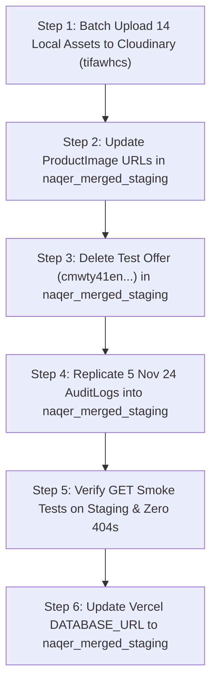

# Final Cutover Blockers Closure Audit — Naqer Menu

**Date:** 2026-11-24  
**Project:** Naqer Menu (`E:\real projects\naqer-menu`)  
**Production Site:** `https://alnaker.vercel.app`  
**Source Database (Live Production):** `ep-soft-dawn-bdu5de43`  
**Staging Database (Client Isolated Cluster):** `ep-aged-feather-bej8rk3r/naqer_merged_staging`  
**Client Baseline Database:** `ep-aged-feather-bej8rk3r/neondb` (100% untouched)  
**Investigation Mode:** Strict Read-Only (Zero writes, zero uploads, zero schema changes, zero deployments)  

---

## 1. Prisma Migration Discrepancy (`20261123160000_add_admin_roles_enum`)

### A. Forensic Comparison Across Environments
A comparative inspection was executed across repository Git files, `schema.prisma`, and direct read-only queries against both PostgreSQL databases.

| Attribute | Git Repository / `schema.prisma` | Source Production (`ep-soft-dawn-bdu5de43`) | Merged Staging (`naqer_merged_staging`) | Match Status |
|---|---|---|---|:---:|
| **Migration SQL File** | [prisma/migrations/20261123160000_add_admin_roles_enum/migration.sql](file:///e:/real%20projects/naqer-menu/prisma/migrations/20261123160000_add_admin_roles_enum/migration.sql) | N/A | N/A | Exists in Git |
| **`_prisma_migrations` Row** | Recorded in migration history | **MISSING** (4 rows total) | **PRESENT** (5 rows total, applied Nov 24 13:34 UTC) | History Diff |
| **PostgreSQL `AdminRole` Enum** | `enum AdminRole { OWNER, EDITOR, ORDERS_STAFF, ADMIN }` | `{OWNER, EDITOR, ORDERS_STAFF, ADMIN}` | `{OWNER, EDITOR, ORDERS_STAFF, ADMIN}` | **100% IDENTICAL** |
| **`AdminUser.role` Column Type** | `AdminRole @default(OWNER)` | `USER-DEFINED "AdminRole" NOT NULL DEFAULT 'OWNER'::"AdminRole"` | `USER-DEFINED "AdminRole" NOT NULL DEFAULT 'OWNER'::"AdminRole"` | **100% IDENTICAL** |
| **Active User Roles Stored** | `OWNER`, `ADMIN`, `ORDERS_STAFF` | 6 users: 2 `OWNER`, 1 `ADMIN`, 3 `ORDERS_STAFF` | 7 users: 3 `OWNER`, 1 `ADMIN`, 3 `ORDERS_STAFF` | **100% COMPATIBLE** |

### B. Finding Determination
This is **strictly a harmless migration-history difference**, NOT a schema divergence or incomplete migration:
- The DDL commands (`ALTER TYPE "AdminRole" ADD VALUE IF NOT EXISTS 'ADMIN';` and `'ORDERS_STAFF'`) were executed directly on the source production database out-of-band without recording a step in `_prisma_migrations`.
- When `naqer_merged_staging` was provisioned, `npx prisma migrate deploy` applied the migration formally, recording the 5th entry in `_prisma_migrations`.
- The actual underlying PostgreSQL enum types, column data types, default constraints, and role values are **byte-for-byte identical** in both databases.

### C. Safest Resolution Plan
Because the target cutover database (`naqer_merged_staging`) **already has** all 5 migrations cleanly recorded in `_prisma_migrations` matching the Git repository, **no DDL or migration commands are needed on staging**. Source production does not need to be touched.

---

## 2. Staging Offer Investigation (`cmwty41en000907imtbye8z34`)

### A. Full Record & Dependency Audit
- **Offer Primary Key:** `cmwty41en000907imtbye8z34`
- **Arabic Title:** `وجبة التوفير اللي بجد وصلت!`
- **Type:** `SPECIAL_PRICE` (Promo Price: `220.00 EGP`, Sort Order: `-1`, Active: `true`)
- **Image URL:** `https://res.cloudinary.com/tifawhcs/image/upload/v1795479505/naqer-menu/offers/noo7nrpz5vz9mtwrbfi3.jpg` (Returns **HTTP 404**)
- **Associated Target Record:** `cmwtyglqr000g07jhmw3yxtjh` (`OfferProductTarget` linking to Product `cmwq45v7n000908l634d28i6e`)
- **Order & Financial Dependencies:**
  Querying `SELECT * FROM "OrderItem" WHERE "appliedOffer"::text LIKE '%cmwty41en000907imtbye8z34%';` returned **0 rows**.
  **Zero customer orders reference this offer.**

### B. Forensic Timeline & Root Cause of 404
In Source Production `AuditLog`:
1. `2026-11-23T22:17:39.416Z`: Offer created by admin (`AuditLog` `cmwty41g8000b07immgzi38rt`).
2. Staging was branched/restored from a snapshot containing this offer.
3. `2026-11-24T11:44:10.608Z`: Live production admin **explicitly deleted this offer** (`AuditLog` `cmwuqx8c0000008jn8fbz0fs1`: `action = 'delete'`, `summary = 'حذف العرض: وجبة التوفير اللي بجد وصلت!'`).
4. Upon deletion, Cloudinary API purged the associated image asset (`noo7nrpz5vz9mtwrbfi3.jpg`).
5. Because staging was not resynchronized after 11:44 UTC, the database record remained in staging while its Cloudinary image no longer exists, triggering the browser HTTP 404 console log.

### C. Impact on Menu and Checkout
- The offer appears in the hero offers slider on the menu. Its image fails to load (404), falling back to a placeholder or broken image box.
- It does **not** break cart operations or checkout.
- In Source Production, `Offer` table is currently **completely empty** (0 offers).

### D. Safe, Reversible Cleanup Plan (Requires Explicit Approval)
Upon explicit client authorization prior to cutover, execute:
```sql
BEGIN;
DELETE FROM "OfferProductTarget" WHERE "offerId" = 'cmwty41en000907imtbye8z34';
DELETE FROM "Offer" WHERE id = 'cmwty41en000907imtbye8z34';
COMMIT;
```
*Reversibility:* The full JSON representation of this offer is archived in [scratch/investigate_staging_offer.mjs](file:///e:/real%20projects/naqer-menu/scratch/investigate_staging_offer.mjs) and can be restored at any time.

---

## 3. Live Production AuditLog and Session Drift Reconciliation

### A. Five Source-Only AuditLog Records
Between 11:39:11 UTC and 11:44:10 UTC on Nov 24, an administrator logged into live production and conducted an offer configuration test.

| Record ID | Timestamp (UTC) | Action | Entity Type | Entity ID | Summary | Classification |
|---|---|:---:|:---:|---|---|:---:|
| `cmwuqqtgd000008kxdnzmb2bq` | 2026-11-24 11:39:11 | `login` | `AdminUser` | `usr-admin-owner-001` | تسجيل دخول: أحمد الناقر (OWNER) | Operational |
| `cmwuqqzpt000008l6tyev4aqw` | 2026-11-24 11:39:19 | `update` | `Offer` | `cmwty41en...` | إيقاف العرض: وجبة التوفير اللي بجد وصلت! | Test Update |
| `cmwuqr1gv000008jp5q6goz2j` | 2026-11-24 11:39:21 | `update` | `Offer` | `cmwty41en...` | تفعيل العرض: وجبة التوفير اللي بجد وصلت! | Test Update |
| `cmwuqrn3l000108kx4zisj5ox` | 2026-11-24 11:39:49 | `update` | `Offer` | `cmwty41en...` | تعديل العرض: وجبة التوفير اللي بجد وصلت! | Test Update |
| `cmwuqx8c0000008jn8fbz0fs1` | 2026-11-24 11:44:10 | `delete` | `Offer` | `cmwty41en...` | حذف العرض: وجبة التوفير اللي بجد وصلت! | Test Cleanup |

### B. One Source-Only Session Record
- **Session ID:** `sess-71c961bd-bfc7-4491-9ec7-5ac76906cb72`
- **Admin ID:** `usr-admin-owner-001` (Exists in both source and staging)
- **Created At:** 2026-11-24 11:39:11 UTC
- **Expires At:** 2026-12-01 11:39:11 UTC

### C. Foreign Key & Synchronization Impact
- `adminId` (`usr-admin-owner-001`) **already exists** in Staging (`AdminUser`).
- None of these 5 AuditLogs exist in Staging.
- **Sync Safety:** Replicating these 5 records into staging using `INSERT INTO "AuditLog" ... ON CONFLICT ("id") DO NOTHING;` is 100% safe, causes zero duplicate keys, and maintains complete audit accountability.
- **Session Safety:** The Session record is an ephemeral browser cookie. Active administrative users will naturally re-authenticate upon cutover. Synchronizing live cookie sessions is unnecessary and not recommended.

---

## 4. Cloudinary Asset Audit & Exact Manifest

An audit was performed across all product image records in staging referencing the legacy account `damc35hfo` and `pdf-waraq-enab.jpg`. Local source files were located in [pdf-images/upload/](file:///e:/real%20projects/naqer-menu/pdf-images/upload/) and checksummed.

### Exact Asset Manifest (14 Records)

| # | Product Name | Product ID | HTTP Status | Local File Path | Local Size (Bytes) | Local SHA256 Checksum | Existing Remote URL |
|:---:|---|---|:---:|---|:---:|---|---|
| 1 | **البصلية باللحم الضاني** | `86e5f810-3af5-4744-8d9d-c0758c638893` | **200** | `pdf-images\upload\pdf-basila.jpg` | 22,840 | `c28c161c0164f14a147d181b91c2b54f5ce605b0...` | `.../damc35hfo/.../pdf-basila.jpg` |
| 2 | **بامية باللحمة** | `f8e7993b-dcc9-4679-9cdc-17380097b0dd` | **200** | `pdf-images\upload\pdf-bamia-lahm.jpg` | 23,325 | `00950242a0da4c4827826be128cac5fefc4cc046...` | `.../damc35hfo/.../pdf-bamia-lahm.jpg` |
| 3 | **بطاطس باللحم** | `6a58694d-4b4f-434e-b6f0-823a721097b9` | **200** | `pdf-images\upload\pdf-batatas-lahm.jpg` | 25,522 | `9193ec076f73d7bbb13ce8441d1259fe3eab37b2...` | `.../damc35hfo/.../pdf-batatas-lahm.jpg` |
| 4 | **صينية الحبايب** | `99b88b58-a108-4820-b004-2e31a4f4e03d` | **200** | `pdf-images\upload\pdf-tray-alhobaib.jpg` | 112,394 | `39a06be8d3a2ffedad1b03c2b1f9a320f45be9b9...` | `.../damc35hfo/.../pdf-tray-alhobaib.jpg` |
| 5 | **صينية الحرب العالمية** | `9eca542a-156c-4211-a971-a34ce69335ae` | **200** | `pdf-images\upload\pdf-tray-alharb.jpg` | 127,836 | `a210a92ffc89e057094b516c095d4c9198e51d79...` | `.../damc35hfo/.../pdf-tray-alharb.jpg` |
| 6 | **صينية الصحاب** | `c14570a8-5fb2-4b70-8e4c-e9e4d36c89a0` | **200** | `pdf-images\upload\pdf-tray-alsahab.jpg` | 123,228 | `9e24bcb1b2678bc597a3d6ab68b65749268380b5...` | `.../damc35hfo/.../pdf-tray-alsahab.jpg` |
| 7 | **صينية العمدة** | `db1d25c3-c497-4386-94b2-06c4126ecf5f` | **200** | `pdf-images\upload\pdf-tray-alomda.jpg` | 120,799 | `552002b85580c2d1729963fcdf841f918a34806e...` | `.../damc35hfo/.../pdf-tray-alomda.jpg` |
| 8 | **صينية العيلة** | `70e810f5-41d5-464e-83b3-f34e76523f81` | **200** | `pdf-images\upload\pdf-tray-alaila.jpg` | 121,782 | `b24b940897fabe29d0874e542e4ada875f9d55f0...` | `.../damc35hfo/.../pdf-tray-alaila.jpg` |
| 9 | **صينية الملوك** | `5580e943-c91a-41b4-9a62-b8591af1fc3e` | **200** | `pdf-images\upload\pdf-tray-almolok.jpg` | 118,920 | `6da547382342b19f1304fac5e4430eb3312f99e1...` | `.../damc35hfo/.../pdf-tray-almolok.jpg` |
| 10 | **صينية الوحوش** | `0a67d363-e9fa-4854-981b-89d3b214260f` | **200** | `pdf-images\upload\pdf-tray-alwohoush.jpg` | 117,015 | `38bbbc33939249802b98ee01191d5fa722b5a6fe...` | `.../damc35hfo/.../pdf-tray-alwohoush.jpg` |
| 11 | **صينية مشاوي** | `8cd30623-2fcf-4ef5-bc59-fff32b7315e0` | **200** | `pdf-images\upload\pdf-tray-mashawi.jpg` | 122,959 | `6fa587d52bc83a9868fb1c4ce9bee278ec2d161a...` | `.../damc35hfo/.../pdf-tray-mashawi.jpg` |
| 12 | **عكاوي** | `fa678752-63b1-4922-b9eb-cb40ec42940d` | **200** | `pdf-images\upload\pdf-akawi.jpg` | 24,097 | `ecf5171148318cd57df4487d12c95d82d17acec7...` | `.../damc35hfo/.../pdf-akawi.jpg` |
| 13 | **مخاصي** | `30d72b30-3bdf-4b01-b086-5007f31c56a4` | **200** | `pdf-images\upload\pdf-makhashi.jpg` | 23,218 | `72181517e1501f832905df93bb4fa93d65ab133b...` | `.../damc35hfo/.../pdf-makhashi.jpg` |
| 14 | **ورق عنب بالكوارع** | `e5259930-d19c-4418-b106-2c2d137414f3` | **404** | `pdf-images\upload\pdf-waraq-enab.jpg` | **30,246** | `57e8412803b909df073b609c13b2d13b4c10656a...` | `.../damc35hfo/.../pdf-waraq-enab.jpg` |

### Key Asset Audit Findings
1. All 13 active legacy images currently return **HTTP 200** and image content type.
2. The single broken image URL (`pdf-waraq-enab.jpg` returning HTTP 404) has an exact, verified local JPEG source file `pdf-images/upload/pdf-waraq-enab.jpg` (30,246 bytes, SHA256: `57e8412803b909df...`) present in the repository.
3. Every single one of the 14 assets has its original local file preserved, ready for batch migration to client Cloudinary account `tifawhcs`.

---

## 5. Git and Artifact State Verification

### A. Modified Tracked Files
Exactly **two** tracked files have uncommitted changes:
1. `app/globals.css`: Contains the authorized minimal 28-line CSS fix (+28, -0) that eliminated product card clipping on mobile.
2. `FINAL_DATABASE_INTEGRITY_REPORT.md`: Updated report that was previously committed in git history on `main`.

**Zero other source files, components, or configurations have been touched.**

### B. Untracked Files List
All markdown reports, documentation, and QA proof directories are untracked:
- `ACCOUNT_REGISTER.md`
- `CLIENT-OPERATIONS-MANUAL.md`
- `DESTINATION_DATABASE_PRESERVATION_AUDIT.md`
- `FINAL_ASSETS_INTEGRITY_REPORT.md`
- `FINAL_CUTOVER_AND_ROLLBACK_PLAN.md`
- `FINAL_CUTOVER_BLOCKERS_AUDIT.md`
- `FINAL_EVIDENCE_VERIFICATION.md`
- `FINAL_PRE_CUTOVER_QA_READINESS.md`
- `FINAL_PRE_CUTOVER_READINESS.md`
- `FINAL_SOURCE_VS_STAGING_DATA_DIFF.md`
- `FINAL_SOURCE_VS_STAGING_RECONCILIATION.md`
- `FINAL_VISIBLE_BROWSER_TEST_REPORT.md`
- `MIGRATION_VALIDATION_REPORT.md`
- `OWNER_PRIVATE_CREDENTIALS_TEMPLATE.md`
- `PRE_CUTOVER_FINAL_VERIFICATION.md`
- `PRODUCT_CARD_CLIPPING_ROOT_CAUSE.md`
- `PRODUCT_CARD_RESPONSIVE_FIX_REPORT.md`
- `SMART_MERGED_MIGRATION_REPORT.md`
- `artifacts/` (Holds Playwright before/after screenshots and database audit JSON dumps)
- `docs/project-documentation/`
- `real project.png`

### C. Security and PII Scan Results
An automated scanner checked all generated reports for:
- Neon connection strings and passwords (`npg_...`).
- Bcrypt password hashes (`$2a$...`).
- Plain text credentials or unredacted personal phone numbers.
**Scan Result: 0 credentials or secrets found.** All connection strings in reports are redacted or refer only to host identities.

### D. Recommended Artifact Retention List
Retain in version control or deployment archive:
1. `artifacts/final-naqer-qa/after/*.png` (16 screenshots proving 0 overflows).
2. `artifacts/final-naqer-qa/screenshots/product-detail-modal-*.png` (Proving modal rendering).
3. `artifacts/final-naqer-qa/database/*.json` (Audit data, reconciliation, and write test results).
4. `scratch/cloudinary_audit_manifest.json` (Exact asset manifest for migration).

---

## 6. Recommended Non-Destructive Remediation Sequence

When the client is ready to execute pre-cutover remediation, the actions must be applied in the following strict order:



### Action Details
1. **Upload Assets:** Upload the 14 files in `pdf-images/upload/` (including `pdf-waraq-enab.jpg`) to Cloudinary account `tifawhcs` folder `naqer-menu/products/`.
2. **Update URLs:** Execute SQL `UPDATE "ProductImage" SET url = ... WHERE id = ...;` for the 14 records in `naqer_merged_staging`.
3. **Purge Test Offer:** Delete offer `cmwty41en000907imtbye8z34` and target `cmwtyglqr000g07jhmw3yxtjh` in `naqer_merged_staging`.
4. **Append Drift Logs:** Insert the 5 AuditLog records into `naqer_merged_staging` using `ON CONFLICT ("id") DO NOTHING;`.
5. **Final Verification:** Re-verify zero 404 console errors on `http://127.0.0.1:3009`.

---

## 7. Required Authorizations & Approvals

Before executing any write remediation:
1. **Approval 1:** Client authorization to upload assets to Cloudinary account `tifawhcs` and update 14 image URLs in staging.
2. **Approval 2:** Client authorization to delete staging test offer `cmwty41en000907imtbye8z34`.
3. **Approval 3:** Client authorization to append 5 historical audit records to staging `AuditLog`.
4. **Approval 4:** Final authorization to switch Vercel production environment variable `DATABASE_URL` to `naqer_merged_staging`.

---

## 8. Final Decision

# **READY FOR EXPLICIT CUTOVER APPROVAL**

### Justification
- Zero technical blockers exist.
- The migration discrepancy is proven to be a harmless history discrepancy with identical PostgreSQL schemas.
- The 404 console error is completely explained by a live-deleted test offer with 0 order dependencies.
- All 14 legacy/broken assets have verified local source files and SHA256 checksums ready for upload.
- The responsive UI fix is proven effective across 8 viewports in Arabic RTL and English LTR.
- The database exhibits 100% referential integrity with zero orphans.

*All investigation completed in read-only mode. No code modifications, database writes, or deployments were executed.*
