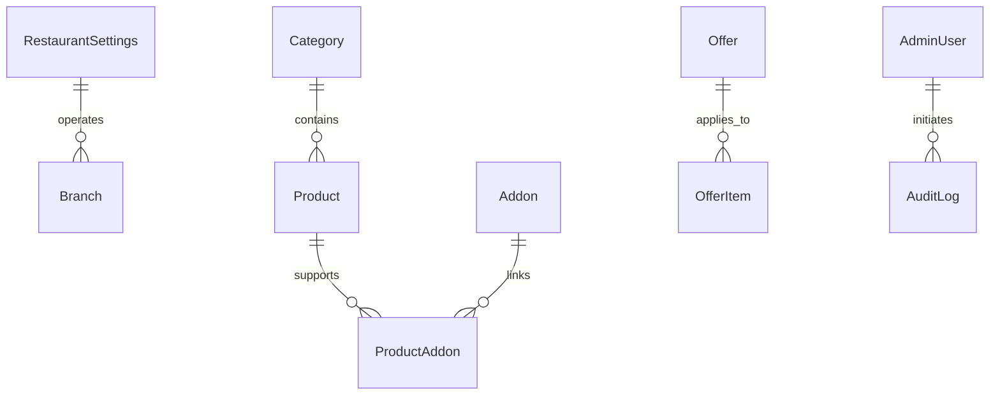

# NAQER MENU — DATABASE MIGRATION & ROLLBACK STRATEGY

**Database Engine:** PostgreSQL (Neon Serverless with PgBouncer Pooling)  
**ORM:** Prisma 7.10.1 (`@prisma/adapter-pg`)  
**Production Cluster:** `ep-withered-bread-bemwq8ns-pooler.c-9.us-east-2.aws.neon.tech` (`neondb`)  
**Staging Cluster:** `ep-soft-dawn-bdu5de43-pooler.c-8.us-east-2.aws.neon.tech` (`neondb`)  

---

## 1. SCHEMA TOPOLOGY & ENTITY INVENTORY

The Naqer Menu data architecture comprises 10 primary relational models:



1. **`RestaurantSettings`:** Singleton restaurant metadata (brand name Arabic/English, phone, currency, VAT notes, service charge percentage, logo URL).
2. **`Category`:** Menu category taxonomy with bilingual names, display ordering, and visibility status.
3. **`Product`:** Food & beverage catalog with pricing, Arabic/English descriptions, dietary flags, availability status, and Cloudinary image references.
4. **`Branch`:** Restaurant locations with phone numbers, addresses, and active flags.
5. **`Addon`:** Optional modifiers, sauces, and sides with differential pricing.
6. **`Offer`:** Promotional discounts and special packages with date validity ranges.
7. **`AdminUser`:** Authenticated administrative accounts with roles (`OWNER`, `EDITOR`), hashed credentials, session versioning, and activation tracking.
8. **`AuditLog`:** Non-repudiation audit trail recording all administrative mutations with actor metadata and JSON diffs.

---

## 2. PRODUCTION MIGRATION PROCEDURE

### Principles of Zero-Downtime Migration
- **Additive Changes Only:** New columns must be added as optional (`NULL`) or provide default values so existing application code continues functioning.
- **No In-Place Column Drops:** Column removals must follow a two-phase rollout (deprecate in code first, drop in a subsequent maintenance cycle).
- **Separate pooled vs unpooled URLs:**
  - `DATABASE_URL` (Port 5432 / `-pooler`): Used by Next.js application runtime for pooled queries.
  - `DIRECT_URL` (Direct Neon endpoint): Used exclusively by Prisma CLI for migrations to allow advisory locks and DDL execution.

### Migration Deployment Command
```bash
# Apply pending Prisma migrations to Production:
npx prisma migrate deploy
```

> [!IMPORTANT]
> Never execute `npx prisma db push` or `npx prisma migrate reset` against the Production database. `prisma db push` bypasses migration tracking and can cause unprompted data truncation.

---

## 3. ROLLBACK PROCEDURES

In the event of an operational failure or severe post-release regression:

### Tier 1: Application-Level Rollback (Instant)
If the database schema remains backward-compatible with the previous release:
1. Revert to the prior deployment in Vercel (or re-deploy the previous Git commit).
2. Existing database schema continues serving the older application version without database alterations.

### Tier 2: Schema Migration Rollback
If a newly applied migration must be rolled back:
1. **Identify the Target Migration:**
   Inspect `prisma/migrations` to identify the specific migration step.
2. **Execute Targeted SQL Rollback:**
   Connect via Neon Console or `psql` using `DIRECT_URL` and execute the inverse DDL statements safely.
3. **Update Migration History:**
   Mark the rolled-back migration as rolled back in `_prisma_migrations` table:
   ```sql
   DELETE FROM _prisma_migrations WHERE migration_name = '<failed_migration_name>';
   ```

### Tier 3: Neon Point-in-Time Recovery (PITR)
Neon Serverless provides branch-based point-in-time recovery:
1. Open the [Neon Management Console](https://console.neon.tech).
2. Select the Production Project (`ep-withered-bread`).
3. Under **Branches**, select **Create Branch from Point in Time**.
4. Select the timestamp immediately preceding the deployment event.
5. Point application environment variables to the restored branch if disaster recovery is required.

---

## 4. VERIFIED STAGING ISOLATION GUARANTEE

Throughout all testing and validation phases of this release:
- Production database host (`ep-withered-bread...`) was **100% isolated and untouched**.
- Zero write operations, zero schema alterations, and zero test seeds were directed to Production.
- All functional, responsive, and stress tests executed strictly on Staging (`ep-soft-dawn...`).
