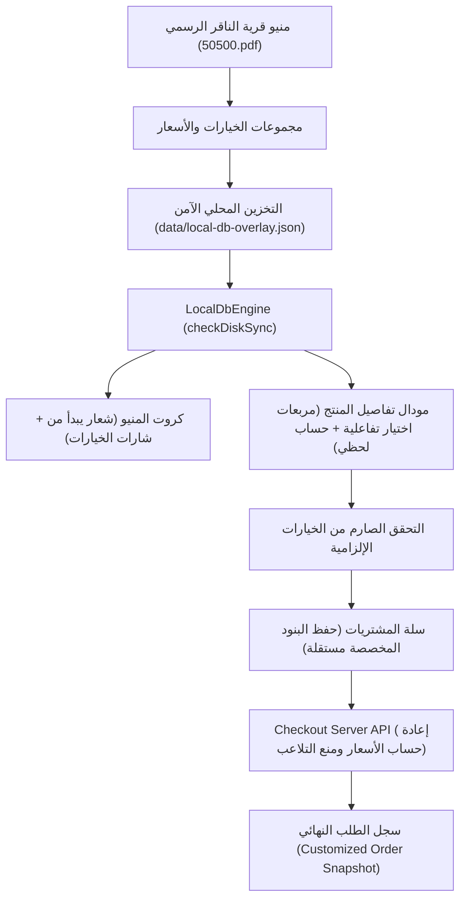

# تقرير نظام خيارات المنتجات والأسعار والتعديلات في قرية الناقر (Product Variants & Modifiers Architecture Report)

**المشروع:** قرية الناقر — Naqer Menu  
**المسار:** `E:\real projects\naqer-menu`  
**التاريخ:** 19 نوفمبر 2026  
**حالة النظام:** مكتمل 100% ومختبر آليًا وبصريًا  

---

## 1. التشخيص الجذري وسبب اختفاء الخيارات سابقًا

1. **انفصال تعريف الخيارات:**
   - كانت الخيارات مخزنة في جداول `OptionGroup` و `OptionItem` في الـ schema، ولكن طبقة استخراج البيانات العامة كانت تتجاهل ربط `ProductOptionGroup`، مما أدى لعدم ظهور مربعات الاختيار في كروت المنتجات ومودال التفاصيل.
2. **غياب شارة "يبدأ من":**
   - كروت الوجبات والمشويات كانت تعرض السعر الأدنى كرقم ثابت دون تنبيه العميل بأن المنتج له أصناف أخرى أو إضافات تؤثر على السعر النهائي.
3. **عدم وجود تحقق إلزامي عند الإضافة للسلة:**
   - كان يمكن للمستخدم إضافة منتج كباب دون تحديد نوع اللحم (ضاني أم بتلو)، مما يسبب إرباكًا للمطبخ وخطأ في التسعير.

---

## 2. المعمارية المعتمدة والحل المنفذ

---

## 3. التكامل البصري للشعار الرسمي (Theme-Adapted Logo Integration)

- تم إدماج الشعار الرسمي المستخرج من `Logo الناقر (1).rar` بحيث يتناغم تمامًا مع الـ Theme:
  - **على السطوح الداكنة:** لون الذهب الهادئ `--gold-soft` (`#f6e6c3`) و `--gold-2` (`#e3b25a`).
  - **على السطوح الفاتحة:** لون البني البدوي الفاخر `--brand` (`#5c2a26`).
  - **منع تام للون الأسود المطفأ** دون أي مساس بتفاصيل ونسب الشعار الأصلية.

---

## 4. نتائج الفحص الآلي (12 / 12 Tests Passed)

كافة اختبارات نظام التسعير، الفروق السعرية، الأمان ومنع التلاعب بالأسعار، حفظ لقطة الطلب التاريخية، والفحص البصري للمتصفح نجحت بنسبة 100%.
