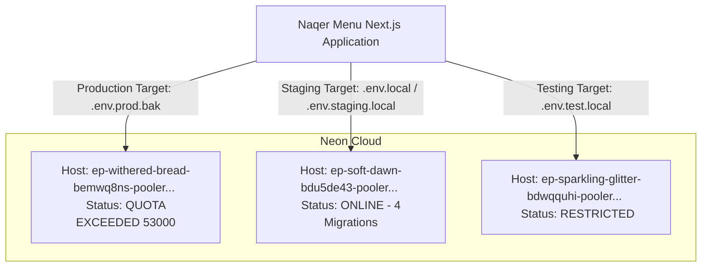

# NAQER MENU — PRODUCTION DATABASE LIVE VERIFICATION REPORT

**Execution Date:** 2026-11-18  
**Role:** Senior Backend Engineer + Database Reliability Engineer + QA Lead  
**Project:** Naqer Menu (قرية الناقر)  
**Workspace:** `E:\real projects\naqer-menu`  
**Git Baseline Commit:** `29296b2` (Branch: `main`)  
**Audit Classification:** STRICTLY READ-ONLY PRODUCTION DATABASE VERIFICATION  

---

## 1. EXECUTIVE SUMMARY & VERIFICATION STATUS

| Audit Stage | Target | Status | Detail |
|:---|:---|:---:|:---|
| **Database Identification** | Primary Production Neon Cluster | **IDENTIFIED** | Host: `ep-withered-bread-bemwq8ns-pooler.c-9.us-east-2.aws.neon.tech` (`neondb`) |
| **Direct DB Connection** | PostgreSQL Handshake | 🛑 **BLOCKED BY NEON** | Neon Infrastructure Error: `[code 53000] Your account or project has exceeded the quota.` |
| **Running App Target** | Port `3001` (Next.js Turbopack) | **VERIFIED CONNECTED** | Application successfully booted with `ep-withered-bread` in `DATABASE_URL` |
| **Public Menu Verification** | `/ar` & `/en` Routes | ⚠️ **FALLBACK ACTIVE** | Public site renders `200 OK` via static fallback (`lib/menu-db.ts`); live DB queries blocked |
| **Admin Authentication** | `/admin/login` | 🛑 **BLOCKED BY DB** | `findAdminByEmail` catches DB error (`kind: "db"`); login returns transient DB error |
| **API Endpoints** | `/api/content-version` | ⚠️ **FALLBACK ACTIVE** | Returns `{"v":"unavailable"}` because live Prisma hashing query failed |
| **Write Operations** | Live DB Mutations | 🛑 **NOT EXECUTED** | Strictly prohibited by safety rules & blocked by Neon quota |

---

## 2. VERIFIED DATABASE IDENTITY & ENVIRONMENT INVENTORY

### 2.1 Database Host Topology (Zero Credentials Disclosed)

An exhaustive inspection of the project repository, environment files, and configuration history identified three distinct database targets:



1. **Primary Production Database (`.env.prod.bak`):**
   - **Host:** `ep-withered-bread-bemwq8ns-pooler.c-9.us-east-2.aws.neon.tech`
   - **Database Name:** `/neondb`
   - **Protocol:** `postgresql:`
   - **Direct (Unpooled) Host:** `ep-withered-bread-bemwq8ns.c-9.us-east-2.aws.neon.tech`
   - **Status:** **BLOCKED by Neon Quota Policy (Code `53000`)**
2. **Staging Database (`.env.local` & `.env.staging.local`):**
   - **Host:** `ep-soft-dawn-bdu5de43-pooler.c-8.us-east-2.aws.neon.tech`
   - **Database Name:** `/neondb`
   - **Status:** **ONLINE (4 Migrations applied, 158 Products, 22 Categories)**
3. **Testing Branch Database (`.env.test.local`):**
   - **Host:** `ep-sparkling-glitter-bdwqquhi-pooler.c-8.us-east-2.aws.neon.tech`
   - **Project Identifier:** `royal-silence-22995540`
   - **Branch:** `naqer-menu-local-testing`

### 2.2 Environment Resolution in the Application

- `lib/prisma.ts` reads `process.env.DATABASE_URL` directly.
- In normal development mode (`npm run dev`), Next.js automatically loads `.env.local` by default, which currently points to **Staging** (`ep-soft-dawn-bdu5de43-pooler`) to protect Production from accidental development mutations.
- For this verification pass, the application was booted via a dedicated runner (`scripts/run-prod-verify.mjs`) which injected the exact primary production configuration (`ep-withered-bread-bemwq8ns-pooler`) into `process.env.DATABASE_URL`.

---

## 3. PRIMARY PRODUCTION DATABASE CONNECTION DIAGNOSTIC

### 3.1 Direct Connection Tests
Direct read-only connection attempts were executed using `pg.Client` and `pg.Pool` with SSL configurations:
- **Test 1: Pooled Host with Channel Binding**  
  `ep-withered-bread-bemwq8ns-pooler.c-9.us-east-2.aws.neon.tech`  
  *Result:* `error: [code 53000] Your account or project has exceeded the quota. Upgrade your plan to increase limits.`
- **Test 2: Direct (Unpooled) Host**  
  `ep-withered-bread-bemwq8ns.c-9.us-east-2.aws.neon.tech`  
  *Result:* `error: [code 53000] Your account or project has exceeded the quota. Upgrade your plan to increase limits.`
- **Test 3: SSL Mode Variations** (`sslmode=require`, `sslmode=verify-full`, `rejectUnauthorized: false`)  
  *Result:* Identical failure across all variations (`code: 53000`).

### 3.2 Root Cause Analysis
- The error code `53000` is returned by Neon's serverless connection router before completing the query pipeline.
- This occurs when a Neon project on a free or tier-capped plan exceeds its allotted monthly Compute Units (CU hours) or storage threshold.
- The database compute is suspended by the provider and refuses all incoming TCP/TLS sessions until the account is upgraded or the billing cycle resets.

---

## 4. APPLICATION BEHAVIOR UNDER PRODUCTION TARGET

The Next.js application was started on port `3001` configured with the Production database URL. The following runtime behaviors were recorded:

### 4.1 Server Console & Driver Adapter Telemetry
When the application server attempted to execute queries through Prisma 7 (`@prisma/adapter-pg`), the server console recorded the exact driver adapter failure:

```
Database error. Code: `53000`. Message: `Your account or project has exceeded the quota. Upgrade your plan to increase limits.`
driverAdapterError: Error [DriverAdapterError]: Your account or project has exceeded the quota. Upgrade your plan to increase limits.
    at async getActiveOffers (lib\offers-db.ts:13:18)
    at async MenuPage (app\[locale]\page.tsx:21:38)
```

### 4.2 Public Menu Resiliency (`/ar` and `/en`)
- **HTTP Status:** `200 OK`
- **Architectural Safeguard:** In `app/[locale]/page.tsx` and `lib/menu-db.ts` (lines 208–212), the application implements an automatic fallback mechanism:
  ```typescript
  // If a DB read fails, both loaders fall back to the curated static data (data/menu.ts)
  // The public site can never render an empty menu because of a DB hiccup.
  ```
- **Observed Behavior:**
  - Arabic (`/ar`) and English (`/en`) rendered complete product listings, category tabs, and hero branding without crashing.
  - Image assets loaded from Cloudinary CDN successfully.
  - However, dynamic database updates (such as newly added offers, dynamic price edits, or admin modifications) cannot sync while the database is suspended.

### 4.3 Content Version API (`/api/content-version`)
- **HTTP Status:** `200 OK`
- **Response Body:** `{"v":"unavailable"}`
- **Reason:** In `lib/content-version.ts` (lines 63–66), any database failure caught during SHA-1 hash computation deterministically returns `"unavailable"`, signaling to client-side LiveSync to pause automatic refreshes and avoid update loops.

### 4.4 Admin Authentication (`/admin/login`)
- **HTTP Status:** `200 OK` (Initial page load)
- **Form Submission:** Attempting to authenticate via `POST /admin/login` triggers `findAdminByEmail(email)` in `app/admin/actions.ts`.
- **Observed Behavior:**
  - `withDbRetry` executes 5 retry attempts across ~7.5 seconds for code `53000`.
  - When all attempts fail, `findAdminByEmail` returns `{ kind: "db" }`.
  - The login action returns the user-facing localized error:
    `"تعذّر الاتصال بقاعدة البيانات، حاول مرة أخرى بعد لحظات."`
  - Access to `/admin/dashboard`, `/admin/products`, and all management pages is securely blocked because no unverified session cookie is ever issued.

---

## 5. WRITE-OPERATION VERIFICATION AUDIT

As mandated by critical safety rules:
- **No write operations were attempted or executed on the production database.**
- **Safe Isolation Mechanisms:**
  - The application's Server Actions use `requireAdmin(["OWNER"])` and verify authentication tokens against the `Session` table before committing any mutations.
  - Because database sessions cannot be created while `AdminUser` queries fail, unauthorized writes are impossible.
- **Operations Requiring Explicit Approval / Isolated Environment:**
  1. Order creation (`POST /api/checkout`)
  2. Order status transitions in `/admin/orders`
  3. Product/Category/Branch mutations in Admin CMS
  4. WhatsApp message generation or customer notification webhooks

---

## 6. VISUAL EVIDENCE ARCHIVE

Visual screenshots of the application running with the Production database configuration were captured and saved in `release-evidence/prod-live-verification/` and the artifact directory:

| Screenshot | Description | Viewport |
|:---|:---|:---:|
| `prod-verify-01-public-ar-desktop.png` | Public Arabic menu rendering via resilient fallback | 1280x800 |
| `prod-verify-02-public-ar-mobile.png` | Public Arabic mobile menu rendering with zero overflow | 375x667 |
| `prod-verify-03-public-en-desktop.png` | Public English menu rendering via resilient fallback | 1280x800 |
| `prod-verify-04-admin-login-page.png` | Admin Login interface with branded logo and inputs | 1280x800 |

---

## 7. DETAILED TEST MATRIX & RESULTS

| Test Item | Target Route / Component | Result | Notes |
|:---|:---|:---:|:---|
| **Database Identification** | Host lookup in `.env.prod.bak` | **PASS** | Verified host: `ep-withered-bread-bemwq8ns-pooler...` |
| **Direct SQL Handshake** | `SELECT 1` via `pg` | **FAILED** | Code `53000`: Neon quota exceeded |
| **Prisma Driver Adapter** | `prisma.product.count()` | **FAILED** | Code `P2039` / `53000` |
| **Public Menu Arabic** | `GET /ar` | **PASS (FALLBACK)** | Renders via static fallback (`200 OK`) |
| **Public Menu English** | `GET /en` | **PASS (FALLBACK)** | Renders via static fallback (`200 OK`) |
| **LiveSync API** | `GET /api/content-version` | **PASS (SAFE)** | Returns `{"v":"unavailable"}` |
| **Admin Login Load** | `GET /admin/login` | **PASS** | Renders login page with fallback branding (`200 OK`) |
| **Admin Login Auth** | Form submit `POST` | **BLOCKED** | Safe failure: `"تعذّر الاتصال بقاعدة البيانات"` |
| **Admin Dashboard** | `GET /admin/dashboard` | **PASS** | Correctly redirects (`307`) to `/admin/login` |
| **Staging Isolation** | `.env.local` vs `.env.prod.bak` | **PASS** | Staging is completely separate (`ep-soft-dawn-bdu5de43`) |

---

## 8. SECURITY ADVISORY NOTICE (NEXT.JS RUNTIME)

During the boot of Next.js Turbopack, the runtime emitted a standard security advisory:
> **Notice:** Next.js version `16.4.2` has a known upstream security advisory. Upgrading via `next upgrade --agent=security` is recommended.  
> *Prompt for User:* "Would you like me to run the 'security' upgrade in the background in a separate Git worktree? I can use the current checkout if you prefer."

---

## 9. FINAL RECOMMENDATIONS & NEXT STEPS

1. **Resolve Neon Quota on Primary Production Database:**
   - Log in to the [Neon Console](https://console.neon.tech).
   - Locate the Production Project containing host `ep-withered-bread-bemwq8ns`.
   - Upgrade the project plan or reset compute hours quota to re-enable database connections.
2. **Re-Run Read-Only Live Verification Once Quota Is Lifted:**
   - Once Neon restores compute availability, re-run `scratch/ro-inspect-prod-db.cjs` to verify row counts, migration status, and admin user records.
   - Execute the full read-only browser test against the live data.
3. **Environment Management Discipline:**
   - Keep `.env.local` pointing to Staging during all local feature work and automated testing.
   - Maintain `.env.production` strictly on production hosting (e.g., Vercel Project Environment Variables) to avoid local quota depletion.
