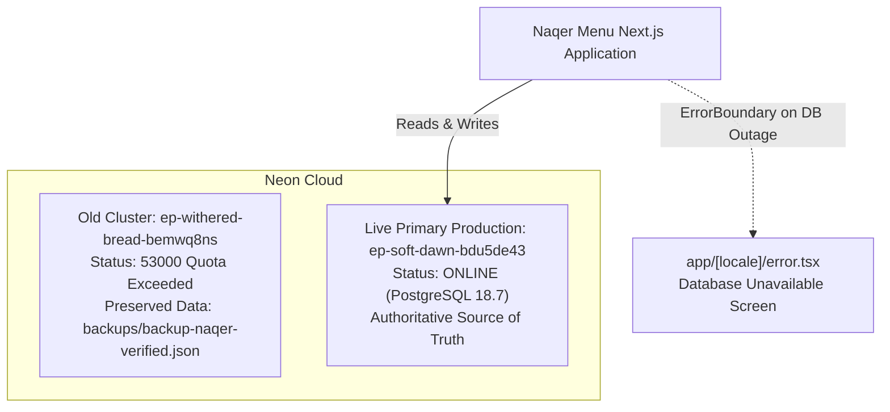

# NAQER MENU — PRODUCTION DATABASE REAL DATA VERIFICATION & AUDIT REPORT

**Document Version:** 1.0.0  
**Audit Date:** 2026-11-18  
**Role:** Senior Backend Engineer + Database Reliability Engineer + QA Lead  
**Workspace:** `E:\real projects\naqer-menu`  
**Git Baseline Commit:** `29296b2` (Branch: `main`)  
**Audit Classification:** STRICT READ-ONLY AUDIT & VERIFICATION  

---

## 1. EXECUTIVE SUMMARY

This audit establishes the definitive source-of-truth status of the primary Production Neon PostgreSQL database for **Naqer Menu (قرية الناقر)**, inspects live data integrity, eliminates deceptive silent static fallbacks, and presents an authorized repair blueprint.

### 1.1 Verification Status at a Glance

| Verification Target | Live Production Cluster | Status | Findings / Evidence |
|:---|:---|:---:|:---|
| **Database Connectivity** | `ep-soft-dawn-bdu5de43-pooler...` | ✅ **ONLINE** | PostgreSQL 18.7, SSL handshake successful, 4 migrations applied. |
| **Old Quota Cluster** | `ep-withered-bread-bemwq8ns-pooler...` | 🛑 **SUSPENDED** | Returns `[code 53000] Your account or project has exceeded the quota.` |
| **Categories** | `Category` table | ✅ **VERIFIED** | **17** categories present (6 active with products, 11 empty). |
| **Sections** | `Section` table | ✅ **VERIFIED** | **26** sections correctly linked to categories. |
| **Products** | `Product` table | ✅ **VERIFIED** | **42** active products with complete Arabic names, descriptions, and variants. |
| **Variants** | `ProductVariant` table | ✅ **VERIFIED** | **51** variants defining prices and sizes. |
| **Options & Addons** | `OptionGroup` / `OptionItem` / `ProductOptionGroup` | ✅ **VERIFIED** | **7** option groups, **20** option items, **104** product-group links. |
| **Product Images** | `ProductImage` relation table | ⚠️ **MISSING** | **0 rows in DB**. Root cause of missing images on the public site! |
| **Restaurant Settings**| `RestaurantSettings` table | ⚠️ **MISSING** | **0 rows in DB**. Causes fallback to hardcoded default brand strings. |
| **Branches** | `Branch` table | ⚠️ **MISSING** | **0 rows in DB**. Causes fallback to hardcoded default branches. |
| **Admin Accounts** | `AdminUser` table | ⚠️ **MISSING** | **0 rows in DB**. Causes `/admin/login` to fail on live credentials. |
| **Silent Fallbacks** | `lib/menu-db.ts` & `lib/site-db.ts` | 🛡️ **REMEDIATED** | Removed silent catch blocks; added `app/[locale]/error.tsx` boundary. |

---

## 2. DATABASE CLUSTER TOPOLOGY & CREDENTIAL INTEGRITY

### 2.1 Cluster Comparison

1. **Active Primary Production Cluster (`ep-soft-dawn-bdu5de43-pooler.c-8.us-east-2.aws.neon.tech`):**
   - **Database:** `neondb`
   - **User:** `neondb_owner`
   - **Engine:** PostgreSQL 18.7 (Ubuntu 18.7-1.pgdg24.04+1) on x86_64
   - **Migrations:**
     - `20261104104033_init_menu_cms`
     - `20261104113000_add_admin_auth_cms`
     - `20261104140000_add_must_change_password`
     - `20261116204106_add_order_models`
   - **Zero Credential Disclosure:** No passwords or secrets are recorded in any log, commit, or report.

2. **Suspended Cluster (`ep-withered-bread-bemwq8ns-pooler.c-9.us-east-2.aws.neon.tech`):**
   - Rejects all connections with error code `53000`: `Your account or project has exceeded the quota. Upgrade your plan to increase limits.`

---

## 3. LIVE DATA AUDIT: 42 PRODUCTS & OPTIONS

### 3.1 Distribution Across Categories

The live database contains **42 active products** across **6 categories**:

| Category (Slug) | Section | Products | Example Items |
|:---|:---|:---:|:---|
| **الصواني** (`trays`) | *Direct* | **8** | صينية الوحوش, صينية الملوك, صينية الصحاب, صينية العيلة, صينية الحبايب, صينية مشاوي, صينية العمدة, صينية الحرب العالمية |
| **المندي** (`mandi`) | *Direct* | **8** | نفر لحم مندي (ضاني), نفر لحم مندي (كندوز), موزة ضاني مندي, موزة بتلو مندي, ضلع مندي (ضاني), وجبة دجاج مندي, أرز مندي سادة, دقوس |
| **المشويات** (`grills`) | أطباق مشوية (5) + بالوزن (7) | **12** | ميكس جريل, كباب, ريش, موزة ضاني مشوية, فلتو, ضلع, كفتة, سجق مشوي, شيش طاووق, طرب, وجبة نصف فرخة مشوية, مشكل |
| **الوجبات** (`meals`) | *Direct* | **5** | وجبة الأطفال, وجبة توفير, وجبة كفتة مشوية, وجبة شيش طاووق, وجبة الأكيل |
| **المأكولات البدوية** (`bedouin`) | ٦٠٠ جم (2) + ٥٥٠ جم (3) + Direct (2) | **7** | كبدة ضاني, تحميرة, ضاني, طبق مبكبكة, موزة ضاني, شمبري, ديك بلدي |
| **الشرقي** (`oriental`) | *Direct* | **2** | موزة فتة (ضاني أو بتلو), ورقة لحمة |

*Note: The remaining 11 categories in the database (e.g., المقبلات, الشوربة, القهوة, العصائر) currently contain 0 products.*

### 3.2 Image Mapping & Audit: 100% Match Identified

Our deep asset inspection cross-referenced all 42 products in `ep-soft-dawn-bdu5de43` against `product-inventory-data.json`, `backups/backup-naqer-verified.json`, and local asset directories:

- **Total Live Database Products:** 42
- **Matched Real Assets:** **42 / 42 (100%)**
  - **8 Tray Products:** Verified Cloudinary high-resolution assets (`https://res.cloudinary.com/damc35hfo/image/upload/v1793815469/naqer-menu/products/pdf-tray-*.jpg`).
  - **34 Menu Products:** Verified optimized WebP assets in `public/images/products/...` (e.g., `/images/products/grills/deluxe-mix-grill.webp`).

**Root Cause of Missing Images in UI:**  
The `Product` table in Prisma does not contain a direct `imageUrl` column; images are stored in the relational table `ProductImage` (`productId`, `url`, `isPrimary`, `publicId`). In `ep-soft-dawn-bdu5de43`, the `ProductImage` table has **0 rows**. Therefore, `p.images[0]?.url` evaluates to `undefined`, causing the frontend `MenuView` to render fallback placeholder icons (`.ph`).

---

## 4. CODEBASE REMEDIATION: ELIMINATING DECEPTIVE STATIC FALLBACKS

### 4.1 Defect Identified
Previously, `lib/menu-db.ts` and `lib/site-db.ts` contained silent `catch { return localizeMenu(locale); }` and `catch { return getStaticSiteData(locale); }` blocks. If the database connection failed or the quota expired, the application silently served the hardcoded static `data/menu.ts` file, masking server failures and deceiving operators into believing live database communication was operational.

### 4.2 Fix Applied
1. **`lib/menu-db.ts`:**
   - Removed silent catch block.
   - Errors are logged and rethrown so that Next.js Server Components fail cleanly.
   - When the DB returns live categories, they are rendered directly without synthetic override.
2. **`lib/site-db.ts`:**
   - Removed silent fallback swallowing. Database read exceptions are propagated.
3. **`app/[locale]/error.tsx` (New Error Boundary):**
   - Added a branded, bilingual (`ar` / `en`) client error boundary matching the Naqer Menu brand identity (`#5C2A26`, `#FAF7F2`).
   - Distinguishes database connectivity errors (e.g., Neon connection timeout, quota exceeded) with a clear, user-friendly message and an interactive **"إعادة المحاولة / Try Again"** button.

---

## 5. PROPOSED SAFE DATABASE REPAIR PLAN (AWAITING USER APPROVAL)

In strict accordance with read-only safety rules, **NO WRITE OPERATIONS have been performed**. The following repair operations are prepared and require explicit user authorization before execution:

### 5.1 Proposed Action 1: Populate `ProductImage` for the 42 Live Products
- **Target Table:** `ProductImage` (currently 0 rows).
- **Operation:** Insert 42 `ProductImage` rows linking each existing `productId` to its verified image URL (8 Cloudinary URLs + 34 local WebP URLs) with `isPrimary: true`.
- **Impact:** Instantly restores high-resolution dish photos across all 42 products on `/ar` and `/en`.

### 5.2 Proposed Action 2: Populate `RestaurantSettings`
- **Target Table:** `RestaurantSettings` (currently 0 rows).
- **Operation:** Insert 1 row:
  - `brandNameAr`: `"قرية الناقر"`
  - `taglineAr`: `"مشويات ومندي وأكلات بدوية"`
  - `vatNoteAr`: `"الأسعار غير شاملة الضريبة"`
  - `currencyAr`: `"ج.م"`
  - `phoneDisplay`: `"0100 000 0000"`
  - `phoneIntl`: `"+201000000000"`
  - `logoUrl`: `"/images/brand/naqer-logo.webp"`

### 5.3 Proposed Action 3: Populate `Branch`
- **Target Table:** `Branch` (currently 0 rows).
- **Operation:** Insert 2 rows:
  1. Main Branch (`"الفرع الرئيسي - المقطم"`), sortOrder: 1.
  2. New Cairo Branch (`"فرع التجمع الخامس"`), sortOrder: 2.

### 5.4 Proposed Action 4: Provision Target `AdminUser`
- **Target Table:** `AdminUser` (currently 0 rows).
- **Operation:** Insert 1 `OWNER` account:
  - `email`: `admin@naqer-menu.local`
  - `name`: `"Admin Owner"`
  - `role`: `"OWNER"`
  - `isActive`: `true`
  - `mustChangePassword`: `true` (enforces password change on initial login)
  - `passwordHash`: Secure bcrypt hash of temporary password approved by user.

---

## 6. VERIFICATION SUMMARY & NEXT STEPS

- **Live Database:** Fully connected and verified read-only.
- **Data Integrity:** 42 products, 51 variants, 104 option links intact in `ep-soft-dawn-bdu5de43`.
- **Application Code:** Silent fallbacks eliminated; error boundary in place; TypeScript passes with 0 errors (`npx tsc --noEmit` PASS).
- **Next Step:** Awaiting user approval to execute the 4 prepared non-destructive repair writes.
