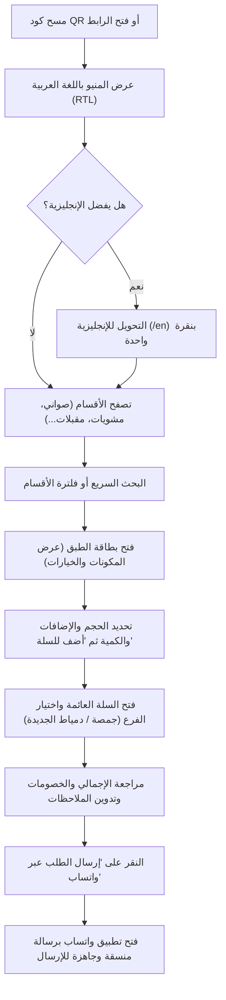

# 01 — نظرة عامة على المشروع (Project Overview)

**اسم المشروع:** منيو قرية الناقر الرقمي (Naqer Menu)  
**طبيعة النظام:** منصة قائمة طعام رقمية تفاعلية ثنائية اللغة (عربي / إنجليزي) مع لوحة تحكم إدارية متكاملة ونظام طلب مباشر عبر واتساب (WhatsApp Direct Ordering).  
**تاريخ التوثيق:** نوفمبر 2026  
**الإصدار:** 1.0.0 (Production Ready)  

---

## 1. الفكرة والغرض من المشروع (Business Purpose)

تم بناء **منيو قرية الناقر** ليحل محل القوائم الورقية والـ PDF التقليدية غير التفاعلية، ويقدم تجربة رقمية عصرية وسريعة لرواد مطاعم "قرية الناقر" في فروعها (فرع جمصة، وفرع دمياط الجديدة).

### المشكلات التي يعالجها النظام:
1. **صعوبة تحديث الأسعار والأطباق:** القوائم الورقية تتطلب إعادة طباعة مكلفة عند أي تعديل، وقوائم الـ PDF تفتقر للمرونة وحجم ملفاتها كبير على باقات هواتف الزبائن.
2. **انعدام التفاعل:** إتاحة تصفح مرئي غني بصور واقعية للأطباق والمشروبات مع تفاصيل المكونات والأسعار والأحجام والإضافات.
3. **تعدد الفروع واختلاف التوجيه:** توجيه الطلب تلقائياً إلى رقم واتساب الخاص بالفرع الذي يختاره الزبون مع تفاصيل الطلب والحساب بدقة تامة.
4. **تحديث فوري دون إعادة تحميل (LiveSync):** إذا قام مدير المطعم بتعديل سعر أو إخفاء طبق نافد من لوحة التحكم، تظهر التعديلات تلقائياً على شاشات الزبائن المتصفحين للمنيو دون الحاجة لإعادة تحميل الصفحة يدوياً.

---

## 2. الجمهور المستهدف وحالات الاستخدام (Target Users & Use Cases)

| فئة المستخدم | واجهة الاستخدام | أبرز حالات الاستخدام |
|:---|:---|:---|
| **زبائن المطعم (رواد الصالة)** | المتصفح عبر مسح كود QR على الطاولات | تصفح الأطباق، استعراض المكونات والصور، اختيار الحجم والإضافات، وإرسال الطلب لواتساب الصالة. |
| **زبائن الدليفري والسفري** | رابط الويب المباشر (`/ar` أو `/en`) | تصفح العروض، تجميع سلة الطلبات، اختيار فرع الاستلام أو التوصيل، وإرسال الطلب بدقة. |
| **إدارة المطعم (OWNER)** | لوحة الإدارة (`/admin/dashboard`) | إدارة الفروع، الأسعار، المنتجات، العروض، الصور، استعراض سجلات التدقيق (Audit Logs). |
| **مشرفو المحتوى (EDITOR)** | لوحة الإدارة (`/admin/dashboard`) | تعديل الأسعار، تحديث توافر الأطباق اليومية، رفع وتحديث صور الأطباق. |

---

## 3. رحلة الزبون الكاملة (Customer Journey)

---

## 4. القدرات الوظيفية الأساسية للمنتج (Core Capabilities)

### أ. واجهة الزبائن العامة (Public Menu):
- **ثنائية اللغة وتوافق الاتجاهات الكامل:** واجهة عربية أصيلة بتخطيط RTL، مع إمكانية التحويل للإنجليزية LTR بسلاسة تامة.
- **عرض بصري متعدد الأنماط:** عرض بطاقات مخصصة للصواني العائلية، بطاقات للمشويات والأطباق الرئيسية، وقوائم مدمجة للمشروبات والمقبلات.
- **محرك بحث وتصفية فوري:** بحث نصي ذكي يتجاهل علامات التشكيل والهمزات العربية.
- **سلة طلبات تفاعلية محلية (Local Storage):** تحفظ خيارات الزبون وتتحمل انقطاع الاتصال المؤقت، وتدعم تعديل الكميات وحساب الخصومات.
- **توليد رسائل واتساب مهيكلة:** توليد نص الطلب تلقائياً متضمناً اسم الطبق، الحجم، الإضافات، الفرع، والإجمالي المالي بدقة.
- **تحديث حي متزامن (LiveSync):** فحص خلفي خفيف (خالٍ من استهلاك البيانات) كل 15 ثانية لتحديث الأسعار وتوافر الأطباق فورياً.

### ب. لوحة التحكم الإدارية (Admin Dashboard):
- **إدارة المنتجات والأقسام:** إنشاء وتعديل وإخفاء وحذف الأطباق وتحديد الأقسام التابعة لها.
- **إدارة الأسعار المتعددة (Variants):** تحديد أسعار متعددة للطبق الواحد (نصف، كيلو، طبق، صينية، إلخ) أو نطاقات سعرية.
- **إدارة الإضافات والخيارات (Add-ons & Options):** مجموعات خيارات إجبارية أو اختيارية (مثل اختيار نوع الأرز أو طلب مقبلات إضافية).
- **العروض والخصومات الترويجية (Offers & Promotions):** دعم خصومات مئوية، أسعار ترويجية، عروض باقات (Bundle)، أو عروض خاصة.
- **مكتبة الصور السحابية (Cloudinary Integration):** رفع الصور وضغطها تلقائياً وتسليمها عبر شبكة CDN عالمية محسنة للهواتف.
- **إدارة الفروع (Branches):** تفعيل أو تعطيل الفروع وتحديث أرقام هواتف الواتساب ومواعيد العمل وإحداثيات الموقع.
- **سجل التدقيق والحماية (Audit Logs):** تتبع وتوثيق كل عملية تعديل أو حذف ينفذها أي مستخدم بالاسم والتاريخ والتفاصيل.

---

## 5. حالة التنفيذ الحالية (Implementation Status)

### الميزات المنفذة والمفحوصة بالكامل (Implemented & Verified):
- قاعدة البيانات الكاملة عبر PostgreSQL / Neon مدعومة بـ 151 طبقاً حقيقياً و18 قسماً وفرعين.
- محرك المصادقة المشفر (Keyed HMAC-SHA256 sessions) وكوكيز آمنة `httpOnly`.
- فصل الصلاحيات بين المالك `OWNER` والمحرر `EDITOR`.
- التوافق الكامل مع Next.js 16 وReact 19 ومكتبة التحقق Zod 4.6.7 (خالية 100% من الثغرات الأمنية).
- واجهة السلة العائمة والربط المباشر مع تطبيق واتساب دون وسيط أو تكاليف رسائل.
- استقرار كامل على بيئات الاستضافة السحابية Vercel وNeon وCloudinary.

### الميزات غير المضمنة (Out of Scope / Not Implemented):
- **بوابات الدفع الإلكتروني (Online Payment Gateway):** لم يُطلب ربط بطاقات بنكية أو محافظ إلكترونية؛ الاعتماد الكامل على الدفع عند الاستلام أو في الصالة.
- **تتبع السائقين (Live GPS Driver Tracking):** النظام مخصص للمنيو والطلب، وليس منصة لوجستية لإدارة مناديب التوصيل.
- **إرسال رسائل SMS أو إيميلات للزبائن:** المصادقة مخصصة لإدارة المطعم فقط؛ الزبائن لا يحتاجون لإنشاء حساب أو تسجيل دخول.

---

## 6. القيود التشغيلية وفرص التطوير المستقبلية (Known Constraints & Roadmap)

1. **الاعتماد على تطبيق واتساب لإتمام الطلب:** يتم تسليم الطلب النهائي كرسالة واتساب؛ مما يعني أن نجاح استلام الطلب يتطلب وجود موظف يتابع هاتف الواتساب المخصص للفرع.
2. **الصور المعروضة:** 14 طبقاً رئيسياً وصينية تعتمد على صور Cloudinary عالية الدقة مستخرجة من أصول المطعم الأصلية، وباقي الأطباق تعتمد على صور WebP محلية مدمجة وخفيفة في مجلد `public/images/`.
3. **التطويرات المستقبلية المقترحة:**
   - ربط طابعة فواتير حرارية (Cloud Thermal Printer) لطباعة الطلب تلقائياً في مطبخ المطعم فور إرسال الزبون للطلب.
   - إضافة نظام إحصائيات متقدم لتحليل الأطباق الأكثر طلباً ومعدلات التصفح اليومية.
