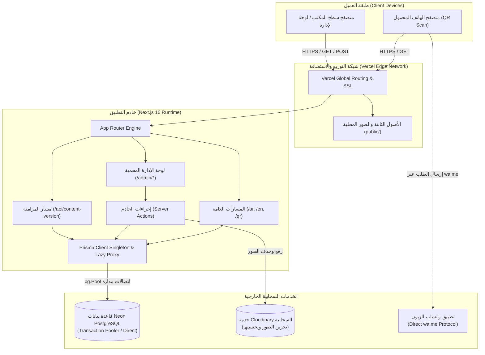

# 02 — البنية التقنية والمعمارية (Technical Architecture)

**المشروع:** منيو قرية الناقر (Naqer Menu)  
**تاريخ التوثيق:** نوفمبر 2026  
**الإصدار:** 1.0.0  

---

## 1. جدول حزمة التقنيات والإصدارات الدقيقة (Tech Stack)

تم اختيار تقنيات حديثة وعالية الكفاءة تضمن سرعة التحميل الفائقة على هواتف الزبائن والأمان الصارم في لوحة الإدارة:

| الطبقة التقنية | التقنية المستخدمة | الإصدار الدقيق | الغرض والمسؤولية |
|:---|:---|:---:|:---|
| **إطار العمل الأساسي** | **Next.js (App Router)** | `16.4.2` | محرك العرض الشامل (SSR / SSG / Server Actions / API Routes). |
| **محرك الواجهات** | **React** | `19.1.0` | بناء المكونات التفاعلية وتحديث الحالة بسلاسة. |
| **لغة البرمجة** | **TypeScript** | `5.9.0` | كتابة كود منضبط الأنواع بنسبة 100% لتفادي أخطاء وقت التشغيل. |
| **قاعدة البيانات** | **Neon PostgreSQL** | Serverless Pg | قاعدة بيانات سحابية حديثة تدعم التوسع والـ Connection Pooling. |
| **طبقة الـ ORM** | **Prisma ORM** | `7.10.1` | نمذجة البيانات وإدارة المخطط وتوليد الـ Client مع `@prisma/adapter-pg`. |
| **إدارة الوسائط** | **Cloudinary SDK** | `2.5.1` (Node) | رفع وتخزين وتحويل وتقديم صور الأطباق والشعارات عبر شبكة CDN. |
| **مخططات التحقق** | **Zod** | `4.6.7` (عبر `zod/v3`) | تدقيق مدخلات النماذج والأمان البرمجي وتفادي ثغرات استنزاف الذاكرة. |
| **تشفير كلمات المرور** | **bcryptjs** | `3.0.2` | تشفير كلمات مرور مديري النظام بـ 12 دورة ملح (Salt Rounds). |
| **توليد رموز الاستجابة** | **qrcode** | `1.5.4` | توليد رموز QR ديناميكية للفروع والطاولات. |
| **إطار الاختبارات** | **Playwright Test** | `1.64.1` | فحص تكامل النظام عبر متصفحات حقيقية (E2E & UI Acceptance). |

---

## 2. مخطط المعمارية العامة للنظام (Architecture Diagram)



---

## 3. تفصيل طبقات النظام ومسؤولياتها

### 3.1. واجهة المستخدم والتصميم (Frontend & Styling)
- **خالية من أطر العمل الثقيلة:** يعتمد المشروع على **Pure Modular CSS** مصمم خصيصاً للمطعم، بدون Tailwind CSS أو Bootstrap، مما يمنح التطبيق:
  - حجم أصول فائق الصغر (Zero Bloat).
  - سرعة تحميل شبه لحظية على شبكات الجيل الثالث والرابع للهواتف.
  - تحكم دقيق في اتجاهات الخطوط والتناسق البصري بين العربي (RTL) والإنجليزي (LTR).
- **التصميم المتجاوب (Responsive Architecture):** تم اختبار وضبط الواجهات على 7 مقاسات شاشات مختلفة تبدأ من الهواتف الصغيرة (360px و 390px) حتى شاشات الحواسيب الواسعة (1920px).

### 3.2. الخادم وإجراءات المعالجة (Backend & Server Actions)
- لا يعتمد التطبيق على خادم Express أو بروتوكول REST منفصل؛ جميع عمليات الكتابة في لوحة الإدارة (إنشاء طبق، تعديل سعر، إخفاء فرع، رفع صورة) تعمل كـ **Server Actions** مدمجة في Next.js.
- **المزايا الأمنية لـ Server Actions:**
  - يتم تنفيذ التحقق من صلاحيات المدير عبر دالة `requireAdmin()` على الخادم حصراً قبل تنفيذ أي كود.
  - لا يتم كشف مسارات الـ API الحساسة أو مفاتيح قواعد البيانات للمتصفح.
  - حماية مدمجة ضد هجمات تزوير الطلبات عبر المواقع (CSRF).

### 3.3. إدارة قاعدة البيانات والاتصالات (Neon & Prisma Driver Adapter)
- **المعالجة الخاصة بالإقلاع البارد (Cold-Start Resilience):**
  تقوم قواعد بيانات Neon السحابية بتعليق وحدات المعالجة تلقائياً عند انعدام النشاط لتوفير الموارد. لذلك تم تزويد المشروع ببركة اتصالات ذكية في [lib/prisma.ts](file:///e:/real projects/naqer-menu/lib/prisma.ts) تعتمد على:
  1. كائن وحيد `pg.Pool` مُدار بدقة مع مهلة اتصال 15 ثانية (`connectionTimeoutMillis: 15000`).
  2. مساعد `withDbRetry()` الذي يعيد المحاولة تلقائياً لثوانٍ معدودة عند حدوث انقطاع مؤقت أو أثناء استيقاظ السيرفر.
  3. توجيه الاستعلامات العادية عبر موزع الاتصالات **Neon PgBouncer Pooler** (المتضمن الرمز `-pooler` في اسم النطاق)، بينما تُنفذ عمليات الترحيل الهيكلي `prisma migrate deploy` عبر الاتصال المباشر غير المجمع (**Direct Connection**).
  4. تغليف كائن `prisma` بـ **Lazy Proxy** يمنع انهيار عمليات البناء (Build Phase) عند استخراج إعدادات المسارات الثابتة.

### 3.4. نظام المزامنة الحية الخفيف (LiveSync Engine)
- لا يستخدم المشروع اتصالات WebSockets المعقدة والمكلفة في الاستضافة؛ بل يعتمد على آلية مبتكرة:
  - يقوم مسار خفيف فائق السرعة `/api/content-version` بإرجاع بصمة تجزئة مدمجة (SHA1 Hash من 16 خانة) تمثل حالة وتاريخ آخر تعديل في جداول المنتجات والأسعار والفروع.
  - يقوم مكون `LiveSync.tsx` في متصفح الزبون بطلب هذه البصمة في الخلفية كل 15 ثانية (وعند عودة الزبون لتفعيل التبويب بعد الخمول).
  - إذا تطابقت البصمة، لا يحدث أي استهلاك للبيانات أو إعادة تحميل.
  - إذا اختلفت البصمة (دلالة على أن الإدارة غيرت سعراً أو أخفت طبقاً)، يقوم المتصفح فوراً باستدعاء `router.refresh()` وتحديث الأسعار أمام الزبون في جزء من الثانية دون وميض الشاشة.

---

## 4. هيكل المجلدات الرئيسي والمسؤوليات (Directory Structure)

```
naqer-menu/
├── app/                        # توجيهات Next.js App Router
│   ├── [locale]/               # المسارات الدولية العامة (/ar و /en)
│   │   ├── page.tsx            # الصفحة الرئيسية للمنيو الرقمي
│   │   └── qr/page.tsx         # صفحة عرض وتنزيل كود QR للفروع
│   ├── admin/                  # مسارات لوحة التحكم الإدارية
│   │   ├── login/              # صفحة تسجيل دخول الإدارة
│   │   ├── (shell)/            # إطار اللوحة المحمي بشريط التنقل والصلاحيات
│   │   │   ├── dashboard/      # الإحصائيات العامة وروابط الإدارة السريعة
│   │   │   ├── products/       # إدارة المنتجات وتعديل الأسعار والخيارات
│   │   │   ├── categories/     # إدارة الأقسام وترتيب العرض
│   │   │   ├── branches/       # إدارة الفروع وتحديث هواتف الواتساب
│   │   │   ├── addons/         # إدارة مجموعات الإضافات والخيارات
│   │   │   ├── offers/         # إدارة العروض الترويجية والخصومات
│   │   │   ├── images/         # استعراض الوسائط وفحص حالة Cloudinary
│   │   │   ├── import/         # مراجعة عمليات الاستيراد التاريخية
│   │   │   ├── audit/          # سجل تدقيق العمليات (OWNER حصراً)
│   │   │   └── settings/       # ضبط هوية المطعم والشعار والضريبة
│   │   └── actions.ts          # دوال خادم تسجيل الدخول والخروج
│   └── api/
│       └── content-version/    # نقطة فحص التحديثات الحية (LiveSync API)
├── components/                 # مكونات الواجهة التفاعلية (MenuView, Cart, Header...)
├── data/
│   └── menu.ts                 # البيانات الاحتياطية الثابتة وفهرس الترجمة الإنجليزية
├── docs/                       # التوثيق والتقارير الفنية
│   └── handbook/               # دليل التشغيل والتسليم الشامل (17 وثيقة)
├── lib/                        # النواة البرمجية والخدمات المشتركة
│   ├── auth.ts                 # إدارة الجلسات وتشفير الكوكيز والأدوار
│   ├── cart.ts                 # منطق السلة وتوليد رسائل واتساب
│   ├── cloudinary.ts           # تكامل ورفع وحذف الصور السحابية
│   ├── prisma.ts               # الاتصال بقاعدة البيانات وإدارة الأخطاء
│   ├── menu-db.ts              # جلب بيانات المنيو وتحويلها للعرض
│   └── site-db.ts              # جلب بيانات الفروع والإعدادات
├── prisma/
│   ├── schema.prisma           # مخطط قاعدة البيانات الشامل
│   └── migrations/             # سجل الترحيلات التاريخية (Forward-only)
├── public/                     # الأصول الثابتة والشعارات والصور المحلية
│   └── images/products/        # الصور المحلية المحسنة بصيغة WebP
├── scripts/                    # أدوات الإدارة والفحص الآلي والتهيئة
└── tests/                      # 14 مجموعة اختبارات مؤتمتة عبر Playwright
```
