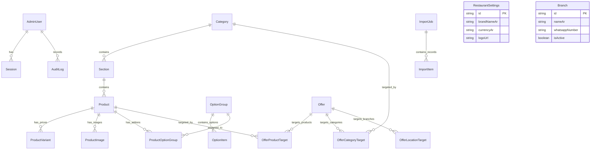

# 03 — قاموس وهيكل قاعدة البيانات (Database & Data Dictionary)

**المشروع:** منيو قرية الناقر (Naqer Menu)  
**المحرك:** PostgreSQL (عبر منصة Neon السحابية)  
**أداة النمذجة (ORM):** Prisma 7 (`schema.prisma`)  
**تاريخ التوثيق:** نوفمبر 2026  

---

## 1. مخطط الكيانات والعلاقات (Entity Relationship Diagram - ERD)

---

## 2. إحصائيات البيانات الفعلية المعتمدة في الإنتاج (Production Verified Counts)

تم التحقق من هذه الأرقام عبر فحص القراءة المباشر لقاعدة بيانات الإنتاج:

| الكيان | إجمالي السجلات في القاعدة | السجلات الحية الفعالة | سجلات الاختبار الملغاة | الملاحظات التشغيلية |
|:---|:---:|:---:|:---:|:---|
| **المنتجات (`Product`)** | **158** | **151** | **7** | 151 طبقاً حقيقياً معتمداً؛ 7 سجلات `ZZ` معطلة كلياً (`isVisible=false`). |
| **الأقسام (`Category`)** | **22** | **18** | **4** | 18 قسماً معتمداً؛ 4 أقسام `ZZ` معطلة كلياً (`isVisible=false`). |
| **العنابر الفرعية (`Section`)** | **31** | **27** | **4** | 27 عنبراً لتصنيف الأطباق داخل الأقسام. |
| **الأسعار والأحجام (`ProductVariant`)** | **174** | **167** | **7** | أسعار فردية ومزدوجة ومقاسات بالأوزان. |
| **الفروع (`Branch`)** | **6** | **2** | **4** | فرعان حقيقيان (`فرع جمصة` و`فرع دمياط الجديدة`) و4 فروع تجارب معطلة. |
| **صور الأطباق (`ProductImage`)** | **151** | **151** | **0** | 14 صورة سحابية على Cloudinary و137 صورة محلية WebP. |
| **العروض الترويجية (`Offer`)** | **0** | **0** | — | مهيأة للاستخدام وجاهزة لإنشاء العروض من اللوحة. |
| **سجلات التدقيق (`AuditLog`)** | **1,416** | **1,416** | — | سجل تاريخي موثق وغير قابل للتعديل لكل عمليات النظام. |

---

## 3. التوثيق التفصيلي لنماذج قاعدة البيانات (Models Dictionary)

### 3.1. نموذج المستخدم الإداري (`AdminUser`)
- **الغرض:** حفظ حسابات مديري ومشرفي النظام للوصول إلى لوحة التحكم الإدارية.
- **الحقول:**
  - `id` (`String` / CUID / PK): المعرّف الفريد.
  - `email` (`String` / Unique): البريد الإلكتروني لتسجيل الدخول.
  - `passwordHash` (`String`): كلمة المرور المجزأة عبر bcrypt بـ 12 دورة.
  - `displayName` (`String`): الاسم الظاهر للمدير في الشريط العلوي وسجلات التدقيق.
  - `role` (`AdminRole` Enum): الصلاحية (`OWNER` لكل شيء، أو `EDITOR` لتعديل المحتوى فقط دون صلاحية الحذف أو إدارة المستخدمين).
  - `isActive` (`Boolean` / افتراضي `true`): تفعيل أو إيقاف الحساب.
  - `lastLoginAt` (`DateTime?`): تاريخ آخر تسجيل دخول ناجح.

### 3.2. نموذج الجلسة المشفرة (`Session`)
- **الغرض:** إدارة جلسات العمل الآمنة في خادم Neon والتحقق الفوري من صلاحية الكوكيز.
- **الحقول:**
  - `id` (`String` / PK).
  - `adminId` (`String` / FK -> `AdminUser.id` مع `onDelete: Cascade`).
  - `tokenHash` (`String` / Unique): بصمة التوكن المشفرة عبر HMAC-SHA256 (لا يتم تخزين التوكن الخام أبداً).
  - `expiresAt` (`DateTime`): تاريخ انتهاء الجلسة (7 أيام).

### 3.3. نموذج إعدادات المطعم العامة (`RestaurantSettings`)
- **الغرض:** سجل فردي أحادي (`id = "default"`) يحفظ الهوية العامة للمطعم.
- **الحقول:**
  - `brandNameAr`: اسم المطعم بالعربية ("قرية الناقر").
  - `taglineAr`: الشعار اللفظي.
  - `logoUrl` / `logoPublicId`: رابط صورة الشعار والمعرّف السحابي على Cloudinary.
  - `vatNoteAr`: ملاحظة الضريبة ("الأسعار شاملة ضريبة القيمة المضافة").
  - `serviceNoteAr`: ملاحظة رسوم الخدمة.
  - `currencyAr`: العملة الافتراضية ("ج.م").

### 3.4. نموذج الفرع (`Branch`)
- **الغرض:** تمثيل الفروع الجغرافية للمطعم وأرقام استلام طلبات الواتساب.
- **الحقول:**
  - `id` (`String` / PK).
  - `nameAr` / `nameEn`: اسم الفرع باللغتين (مثال: "فرع جمصة" / "Gamasa Branch").
  - `addressAr` / `addressEn`: العنوان بالتفصيل.
  - `cityAr`: المدينة (جمصة / دمياط الجديدة).
  - `whatsappNumber`: رقم هاتف الواتساب المخصص لاستقبال طلبات هذا الفرع.
  - `isOrderable` (`Boolean`): هل يستقبل الفرع طلبات أونلاين حالياً؟
  - `isActive` (`Boolean`): هل يظهر الفرع في قائمة فروع المطعم؟

### 3.5. نموذج القسم (`Category`)
- **الغرض:** التصنيفات الرئيسية للمنيو (صواني، مشويات، مقبلات، مشروبات...).
- **الحقول:**
  - `slug` (`String` / Unique): المعرف النصي الثابت المستخدم للربط والترجمة (مثل `trays`, `mandi`, `grills`).
  - `nameAr`: الاسم العربي للقسم.
  - `icon`: الرمز التعبيري (Emoji) الظاهر في شريط التنقل.
  - `group` (`MenuGroup` Enum): تصنيف القسم هل هو أطعمة `FOOD` أو مشروبات `DRINKS`.
  - `layout` (`CategoryLayout` Enum): نمط العرض البصري: `TRAYS` (بطاقات صواني عريضة) أو `LIST` (قائمة عادية).
  - `imageUrl` / `imagePublicId`: صورة الغلاف السحابية للقسم على Cloudinary.
  - `isVisible` (`Boolean`): إظهار أو إخفاء القسم بالكامل من الواجهة.
  - `sortOrder` (`Int`): ترتيب ظهور القسم في شريط التبويبات.

### 3.6. نموذج العنبر / التصنيف الداخلي (`Section`)
- **الغرض:** تقسيم فرعي داخلي للقسم لتنظيم الأطباق (مثال: "بالكيلو"، "أطباق مفردة"، "مشروبات ساخنة").
- **الحقول:**
  - `categoryId` (`String` / FK -> `Category.id` مع `onDelete: Cascade`).
  - `titleAr` (`String?`): عنوان العنبر الظاهر أعلى الأطباق التابعة له.
  - `sortOrder` (`Int`): ترتيب العنبر داخل القسم.

### 3.7. نموذج المنتج / الطبق (`Product`)
- **الغرض:** الحاوية الأساسية لكل صنف في المنيو.
- **الحقول:**
  - `sectionId` (`String` / FK -> `Section.id` مع `onDelete: Cascade`).
  - `nameAr`: اسم الطبق باللغة العربية (مثال: "صينية الوحوش"، "كباب ضاني").
  - `descAr`: الوصف التفصيلي لمكونات الطبق.
  - `badge` (`ProductBadge?` Enum): شارة تمييز (`SIGNATURE` للطبق المميز، أو `OFFER` لعروض خاصة).
  - `ingredientsAr` (`String[]`): مصفوفة نصوص للمكونات الأساسية تظهر كـ Chips بصرية في بطاقات الصواني.
  - `isAvailable` (`Boolean`): هل الصنف متوفر اليوم أم نافد؟
  - `isVisible` (`Boolean`): هل يظهر الصنف في المنيو أصلاً؟
  - `isFeatured` (`Boolean`): هل يبرز الصنف في أعلى القسم؟

### 3.8. نموذج الأسعار والأحجام (`ProductVariant`)
- **الغرض:** دعم التسعير المتعدد للطبق الواحد دون تكرار إنشاء الطبق.
- **الحقول:**
  - `productId` (`String` / FK -> `Product.id` مع `onDelete: Cascade`).
  - `labelAr` (`String?`): تسمية الحجم أو الوزن (مثال: "نصف كيلو"، "فردي"، "جامبو"، أو `null` إذا كان للطبق سعر واحد).
  - `price` (`Decimal(10, 2)`): السعر الأساسي.
  - `maxPrice` (`Decimal(10, 2)?`): الحد الأقصى للسعر في حال كان التسعير بالنطاق (مثال: "60 - 95 ج.م").

### 3.9. نموذج صور المنتجات (`ProductImage`)
- **الغرض:** ربط الصور بالأطباق مع دعم تعدد الصور وتحديد الصورة الأساسية.
- **الحقول:**
  - `productId` (`String` / FK -> `Product.id` مع `onDelete: Cascade`).
  - `url` (`String`): رابط الصورة (إما رابط HTTPS سحابي من Cloudinary أو مسار محلي من `/images/products/`).
  - `publicId` (`String?`): المعرف الفريد في Cloudinary لحذف الصورة القديمة تلقائياً عند استبدالها.
  - `isPrimary` (`Boolean`): تحديد الصورة كصورة غلاف رئيسية للطبق في المنيو.

### 3.10. نماذج الإضافات والخيارات (`OptionGroup` & `OptionItem` & `ProductOptionGroup`)
- **الغرض:** إتاحة خيارات إضافية للزبون داخل بطاقة الطبق (مثل: اختيار نوع الأرز، طلب مقبلات إضافية، خيارات التسوية).
- **العلاقات:** علاقة Many-to-Many بين المنتجات ومجموعات الخيارات عبر جدول وسيط `ProductOptionGroup`.

### 3.11. نماذج العروض والخصومات (`Offer` وتوابعها)
- **الغرض:** إدارة التخفيضات والعروض المؤقتة أو المستمرة.
- **أنواع العروض المدعومة (`OfferType`):**
  - `PERCENTAGE`: نسبة مئوية مخصومة من السعر (مثل خصم 10%).
  - `FIXED_AMOUNT`: خصم مبلغ نقدي ثابت (مثل خصم 50 ج.م).
  - `SPECIAL_PRICE`: سعر ترويجي خاص للطبق.
  - `BUNDLE`: عرض وجبة مجمعة.
  - `BUY_X_GET_Y`: اشترِ عدداً واحصل على هدايا.

### 3.12. نموذج سجل التدقيق الرقابي (`AuditLog`)
- **الغرض:** توثيق كل حركة إدارية تحدث في اللوحة لمنع التلاعب وتحديد المسؤوليات.
- **الحقول:**
  - `adminId` (`String?` / FK -> `AdminUser.id` مع `onDelete: SetNull`).
  - `action`: نوع العملية (`create`, `update`, `delete`, `publish`).
  - `entityType`: الكيان المعدل (`Product`, `Category`, `Branch`, `Offer`, إلخ).
  - `summary`: ملخص إنساني باللغة العربية للعملية (مثال: "تعديل سعر كباب ضاني").
  - `changes`: حقل `Json` يحتوي على لقطة دقيقة للبيانات قبل التعديل وبعده (`before` / `after`).
