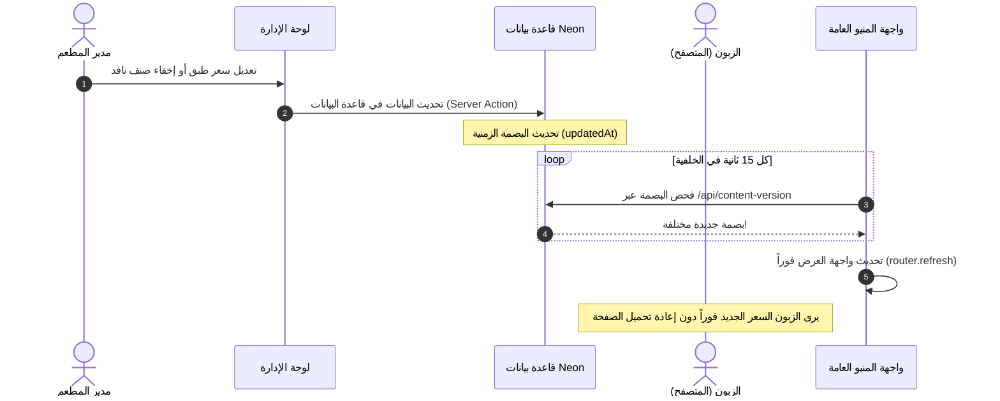

# 06 — دليل تصفح المنيو العام وطلب الوجبات (Public Menu & Ordering Manual)

**المشروع:** منيو قرية الناقر (Naqer Menu)  
**المسار العام:** `/ar` و `/en`  
**تاريخ التوثيق:** نوفمبر 2026  

---

## 1. التصفح وتجربة المستخدم (Public Navigation Experience)

### 1.1. ثنائية اللغة وتبديل الاتجاه (RTL / LTR)
- **الافتراضي:** يتم تحميل المنيو باللغة العربية بتنسيق واتجاه من اليمين إلى اليسار (`dir="rtl"`).
- **التبديل إلى الإنجليزية:** يوجد زر تبديل اللغة أعلى الصفحة (أو في القائمة العلوية). عند النقر عليه يتحول الرابط إلى `/en`، ويتحول التصميم بالكامل إلى اليسار لليمين (`dir="ltr"`) دون انكسار بصري، وتظهر أسماء الأطباق والتصنيفات بالإنجليزية المستمدة من الفهرس المرجعي الموثق.

### 1.2. تصفح الأقسام والبحث الفوري
- **شريط الأقسام السريع (Category Bar):** يظهر في أعلى الشاشة ويتيح القفز السريع بين الأقسام (الصواني، المشويات، الطواجن، المقبلات، المشروبات).
- **محرك البحث الذكي:** خانة بحث سريعة تمكن الزبون من كتابة اسم الصنف (مثل: "كباب"، "ماندي"، "موزة"). المحرك مبرمج بذكاء ليتجاهل الفروق بين الهمزات (أ، إ، آ، ا) وحروف الياء والألف المقصورة (ي، ى).

---

## 2. عرض الأطباق والخيارات المتقدمة (Dish Cards & Modals)

1. **بطاقات الصواني العائلية (Tray Cards):**
   - تعرض أسماء الصواني الشهيرة (صينية الوحوش، صينية الملوك، صينية الصحاب).
   - تتضمن صورة حقيقية وواضحة، وسعر الصينية، والمكونات المرفقة معها (مثل: أرز بسمتي، كفتة، شيش، طحينة، سلطات).
2. **نافذة تفاصيل الطبق (Product Detail Modal):**
   - عند النقر على أي طبق، تفتح نافذة منبثقة غنية تعرض:
     - الصورة الكاملة بدقة عالية.
     - الوصف الكامل والمكونات.
     - **محدد الأحجام / الأوزان (Variants):** يختار الزبون الحجم المطلوب (مثل: ربع كيلو / نصف كيلو / كيلو كامل)، ويتحدث السعر الظاهر لحظياً.
     - **الإضافات والخيارات (Add-ons):** في حال توفر خيارات للطبق (مثل: صوصات إضافية، نوع الأرز، طلب خضار مشوي).
     - **محدد الكمية:** زر زيادة (+) ونقصان (-) لتحديد عدد الأطباق.
     - زر **"أضف للسلة"** لحفظ الاختيار.

---

## 3. السلة التفاعلية واختيار الفرع (Cart Drawer & Branch Selection)

- **الشريط العائم (Floating Cart Bar):** بمجرد إضافة أول طبق، يظهر شريط عائم في أسفل شاشة الهاتف يعرض:
  - عدد الأصناف المختارة.
  - إجمالي المبلغ المستحق.
  - زر **"عرض السلة"**.
- **محتويات درج السلة (Cart Drawer):**
  1. قائمة الأطباق المختارة مع تفاصيل الحجم والإضافات والكمية.
  2. إمكانية تعديل الكمية أو حذف الصنف أو تفريغ السلة بالكامل.
  3. **محدد الفرع المستلم (Branch Selector):** قائمة منسدلة إجبارية لاختيار الفرع المسؤول عن الطلب:
     - **فرع جمصة**
     - **فرع دمياط الجديدة**
     *(لا يمكن للزبون النقر على زر الطلب دون تحديد الفرع لضمان عدم توجيه الطلب لرقم خاطئ).*
  4. **مربع الملاحظات الخاصة:** خانة تتيح للزبون كتابة ملاحظات مثل "بدون بصل"، "توصيل للطاولة رقم 5"، أو "يرجى وضع الخبز ساخناً".
  5. ملخص الحساب المالي متضمناً ملاحظة الضريبة والخدمة.

---

## 4. توليد رسالة الطلب عبر واتساب (WhatsApp Order Message Format)

عند نقر الزبون على زر **"إرسال الطلب عبر واتساب"**:
1. يقوم النظام بقراءة رقم هاتف الواتساب المخصص للفرع الذي اختاره الزبون من قاعدة البيانات (مثل: `201094965222`).
2. يقوم بإنشاء رابط ويب بروتوكولي بصيغة:
   `https://wa.me/201094965222?text=<ENCODED_MESSAGE>`
3. يُفتح تطبيق واتساب على هاتف الزبون تلقائياً برسالة جاهزة للمراجعة والإرسال تحتوي على النموذج التالي:

```text
🍽️ *قرية الناقر*
📋 *طلب جديد من المنيو الإلكتروني*
🏢 *الفرع المستلم:* فرع جمصة
📍 *عنوان الفرع:* طريق المنصورة - جمصة الدولي
────────────────────
1. *صينية الوحوش*
   • الكمية: 1
   • السعر: 1850 ج.م

2. *كباب وكفتة مشكل* (نصف كيلو)
   • الكمية: 2
   • السعر: 760 ج.م
   • الإضافات: صوص طحينة إضافي (+20 ج.م)

────────────────────
📝 *ملاحظات الزبون:* يرجى تجهيز الطلب للاستلام الساعة 7 مساءً
────────────────────
💵 *الإجمالي النهائي:* 2630 ج.م
📌 الأسعار شاملة ضريبة القيمة المضافة
```

---

## 5. كيف تظهر تعديلات الإدارة للجمهور (Live Content Synchronization)


