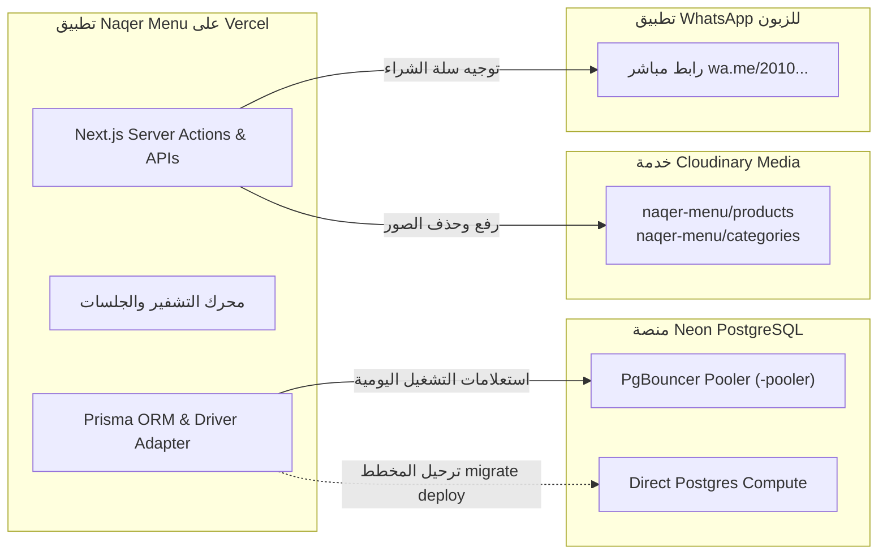

# 07 — متغيرات البيئة والتكاملات السحابية (Environment & Integrations)

**المشروع:** منيو قرية الناقر (Naqer Menu)  
**تاريخ التوثيق:** نوفمبر 2026  

---

## 1. الدليل المرجعي لمتغيرات البيئة السبعة (The 7 Exact Variables)

يعتمد النظام بدقة على **7 متغيرات بيئة أساسية** فقط. ستة منها مخصصة للخادم وتعتبر سرية للغاية، ومتغير واحد فقط متاح للواجهة العامة:

| # | اسم المتغير (Exact Key) | النطاق (Scope) | طبيعة الاستخدام | مكان الاستهلاك في الكود | الوصف وكيفية الحصول على القيمة |
|:---|:---|:---:|:---:|:---|:---|
| 1 | `DATABASE_URL` | **سري** (Server) | وقت التشغيل (Runtime) | [lib/prisma.ts](file:///e:/real projects/naqer-menu/lib/prisma.ts) | رابط اتصال قاعدة بيانات Neon المجمّع (`-pooler`). يُجلب من لوحة تحكم Neon (Connection Details). |
| 2 | `SESSION_SECRET` | **سري** (Server) | وقت التشغيل (Runtime) | [lib/auth.ts](file:///e:/real projects/naqer-menu/lib/auth.ts) | مفتاح تشفير عالي التعقيد (≥64 حرفاً عشوائياً) لتشفير جلسات الأدمن عبر HMAC-SHA256. |
| 3 | `CLOUDINARY_CLOUD_NAME` | **سري** (Server) | وقت التشغيل (Runtime) | [lib/cloudinary.ts](file:///e:/real projects/naqer-menu/lib/cloudinary.ts) | اسم حساب Cloudinary (مثل `damc35hfo`). يُجلب من لوحة Cloudinary Dashboard. |
| 4 | `CLOUDINARY_API_KEY` | **سري** (Server) | وقت التشغيل (Runtime) | [lib/cloudinary.ts](file:///e:/real projects/naqer-menu/lib/cloudinary.ts) | مفتاح الـ API العام للوصول السحابي لحساب Cloudinary. |
| 5 | `CLOUDINARY_API_SECRET` | **سري** (Server) | وقت التشغيل (Runtime) | [lib/cloudinary.ts](file:///e:/real projects/naqer-menu/lib/cloudinary.ts) | المفتاح السري لعمليات رفع وحذف الصور من سيرفرات Cloudinary. |
| 6 | `CLOUDINARY_SECURE_FOLDER` | **سري** (Server) | وقت التشغيل (Runtime) | [lib/cloudinary.ts](file:///e:/real projects/naqer-menu/lib/cloudinary.ts) | اسم المجلد الجذري لعزل صور المطعم (القيمة المعتمدة: `naqer-menu`). |
| 7 | `NEXT_PUBLIC_SITE_URL` | **عام** (Universal) | بناء وتشغيل | [components/JsonLd.tsx](file:///e:/real projects/naqer-menu/components/JsonLd.tsx) | الرابط الرسمي الكامل للموقع (مثل `https://menu.naqer.com`) لتوليد كود الـ SEO والـ QR. |

---

## 2. جدول بيئات الضبط في منصة Vercel (Vercel Environments Mapping)

عند ضبط هذه المتغيرات في منصة الاستضافة السحابية Vercel (تحت **Project Settings > Environment Variables**):

| اسم المتغير | Production | Preview | Development | ملاحظات هامة |
|:---|:---:|:---:|:---:|:---|
| `DATABASE_URL` | ✔ | ✔ | ✔ | تأكد من تفعيل الاتصال المشفر `?sslmode=verify-full`. |
| `SESSION_SECRET` | ✔ | ✔ | ✔ | يجب توليد قيمة عشوائية جديدة عبر `openssl rand -hex 32`. |
| `CLOUDINARY_CLOUD_NAME` | ✔ | ✔ | ✔ | مطابق لحساب Cloudinary. |
| `CLOUDINARY_API_KEY` | ✔ | ✔ | ✔ | مطابق للمفتاح في Cloudinary. |
| `CLOUDINARY_API_SECRET` | ✔ | ✔ | ✔ | لا تشاركه أبداً في أي محادثة عامة. |
| `CLOUDINARY_SECURE_FOLDER` | ✔ | ✔ | ✔ | اكتب: `naqer-menu`. |
| `NEXT_PUBLIC_SITE_URL` | ✔ | ✔ | ✔ | الرابط الفعلي للإنتاج أو نطاق Vercel الافتراضي. |

---

## 3. التكاملات السحابية الخارجية (External Services Architecture)



---

## 4. نموذج ملف البيئة الآمن الخالي من الأسرار (`.env.example`)

انسخ هذا الملف وأنشئ ملفاً محلياً باسم `.env.local` في بيئة تطويرك الخاصة مع ملء القيم الصحيحة:

```bash
# ------------------------------------------------------------------------------
# NAQER MENU — ENVIRONMENT CONFIGURATION TEMPLATE
# تنبيه أمني: لا ترفع أبداً هذا الملف مع قيم حقيقية إلى Git
# ------------------------------------------------------------------------------

# 1. قاعدة البيانات (Neon PostgreSQL Connection String)
# استخدم رابط الـ Pooler لوقت التشغيل:
DATABASE_URL="postgres://[USER]:[PASSWORD]@[NEON_HOST]-pooler.c-9.us-east-2.aws.neon.tech/neondb?sslmode=verify-full"

# 2. أمان الجلسات (Session Secret Key - قم بتوليد قيمة قوية)
SESSION_SECRET="generate-a-strong-random-64-char-secret-key-here"

# 3. إعدادات Cloudinary لرفع الصور
CLOUDINARY_CLOUD_NAME="your_cloud_name"
CLOUDINARY_API_KEY="your_api_key"
CLOUDINARY_API_SECRET="your_api_secret"
CLOUDINARY_SECURE_FOLDER="naqer-menu"

# 4. الرابط العام للموقع (Public Canonical Site URL)
NEXT_PUBLIC_SITE_URL="https://menu.naqer.com"
```
