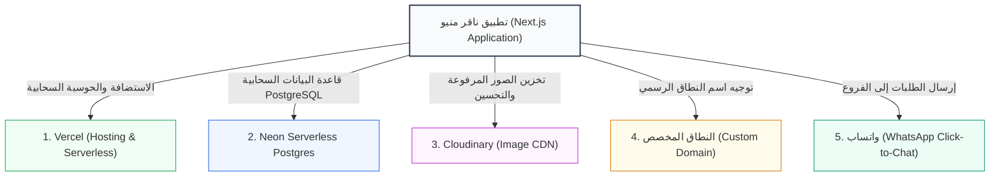

# 08 — الخدمات الخارجية، الاشتراكات والتكاليف التشغيلية (External Services, Subscriptions & Operating Costs)

يوثق هذا الدليل كافة الخدمات السحابية والطرف الثالث (Third-Party Services) المرتبطة بنظام «ناقر منيو» (Naqer Menu)، مع تفصيل خطط الأسعار المجانية والمدفوعة، حدود الاستخدام، وتكاليف التشغيل المتوقعة بدقة وشفافية كمرجع لصاحب المطعم والمطور.

---

## 1. فهرس الخدمات الخارجية المرتبطة بالنظام (Service Inventory)

يعتمد النظام على **4 خدمات سحابية خارجية أساسية** وخدمة واحدة مجانية تماماً:

---

## 2. تفاصيل الخطط والأسعار لكل خدمة (محدثة ومحققة لشهر نوفمبر 2026)

### 2.1. منصة الاستضافة: Vercel

* **الدور في النظام:** استضافة كود Next.js 16، تشغيل خوادم Serverless Function لمعالجة الـ API والـ SSR، وتوفير شبكة توصيل المحتوى العالمية (Vercel Edge Network).
* **الخطة المجانية (Hobby Plan):**
  * التكلفة: **0$ / شهر** (مجاناً للاستخدام الشخصي والتطوير).
  * الحدود: 100 جيجابايت نقل بيانات (Bandwidth) شهرياً، 100 ساعة تشغيل لوظائف Serverless، شهادات SSL تلقائية مجانية، دعم نطاقات مخصصة مجاناً.
  * القيود: مخصصة للمطور المستقل؛ تمنع الاستخدام التجاري للفرق (Commercial Team Collaboration).
* **الخطة المدفوعة (Pro Plan):**
  * التكلفة: **20$ / شهر لكل عضو فريق** (تم التحقق: $20/month per seat).
  * المزايا: مرخصة للاستخدام التجاري الصريح للشركات والفرق، 1 تيرابايت نقل بيانات، دعم فني متقدم، تحليلات متقدمة للأداء، وسجلات تنفيذ ممتدة.
* **متى يجب الترقية؟**
  * إذا رغب المطعم في امتلاك فريق عمل متعدد على Vercel أو تجاوزت الزيارات 50,000 زائر نشط شهرياً أو تم طلب الامتثال التجاري الكامل لسياسة Vercel.

---

### 2.2. قاعدة البيانات السحابية: Neon (Serverless PostgreSQL)

* **الدور في النظام:** تخزين كافة البيانات العلاقية (المنتجات، الأقسام، التصنيفات، الأسعار، الفروع، سجلات التدقيق).
* **الخطة المجانية (Free Tier):**
  * التكلفة: **0$ / شهر**.
  * الحدود: مساحة تخزين 0.5 جيجابايت (512 ميجابايت)، قوة معالجة حاسوبية مشتركة (Shared Compute) تصل إلى 0.25 vCPU، التوقف التلقائي للـ Compute بعد 5 دقائق من الخمول (Scale-to-zero) لتوفير الموارد.
  * الملاءمة للمشروع: قاعدة بيانات ناقر منيو الحالية تشغل أقل من **15 ميجابايت** (158 منتجاً، 6 فروع، 1,416 سجل تدقيق)، وبالتالي الخطة المجانية كافية جداً لحجم البيانات الحالي.
  * عيب الخطة المجانية: حدوث تأخير خفيف (Cold Start يتراوح بين 1-2 ثانية) عند أول طلب بعد فترة خمول طويلة (معالج برمجياً في الكود بواسطة آلية `withDbRetry`).
* **الخطة المدفوعة (Launch Plan):**
  * التكلفة: **~19$ / شهر** (السعر الرسمي لـ Neon Launch Plan: $19/month).
  * المزايا: مساحة تخزين 10 جيجابايت، معالج Compute مخصص دائم العمل (Always-on بدون Cold Start)، استعادة فورية لنسخ احتياطية سابقة (7-day Point-in-Time Recovery).
* **متى يجب الترقية؟**
  * عندما يرغب صاحب المطعم في إلغاء الـ Cold Start تماماً لضمان استجابة لحظية في ثوانٍ معدودة طوال الـ 24 ساعة، أو عند نمو سجلات التدقيق والعمليات.

---

### 2.3. إدارة وتحسين الصور: Cloudinary

* **الدور في النظام:** استضافة الصور التي يرفعها المشرف عبر لوحة التحكم، وتوليد صور مصغرة تلقائياً بصيغ WebP/AVIF فائقة الضغط.
* **الخطة المجانية (Free Tier):**
  * التكلفة: **0$ / شهر**.
  * الحدود: **25 رصيداً شهرياً (Monthly Credits)**. كل رصيد يعادل 1,000 تحويل للصورة (Transformation) أو 1 جيجابايت مساحة تخزين أو 1 جيجابايت باندويث.
  * الملاءمة للمشروع: يحتوي النظام على 14 صورة سحابية فقط على Cloudinary و137 صورة محلية مُحسنة، واستهلاك الرصيد الفعلي يقل عن **0.5 رصيد شهرياً**، مما يعني أن الخطة المجانية كافية بنسبة 100% للمطعم لسنوات.
* **الخطة المدفوعة (Plus Plan):**
  * التكلفة: **~89$ / شهر** (السعر يحتاج مراجعة من الموقع الرسمي لشركة Cloudinary لكونه مخصصاً للمؤسسات الكبرى).
  * متى يجب الترقية؟ عملياً لن يحتاج المطعم الترقية نهائياً إلا إذا تجاوز عدد الصور المرفوعة 20,000 صورة أصلية بدقة فائقة.

---

### 2.4. اسم النطاق الرسمي (Custom Domain)

* **الدور في النظام:** الرابط الذي يكتبه الزبون أو يُقرأ عبر رمز الـ QR (مثل: `menu.naqer.com` أو `naqermenu.com`).
* **التكلفة:** **10$ إلى 15$ سنوياً** (تدفع لشركات تسجيل النطاقات مثل Cloudflare Registrar أو Namecheap أو GoDaddy).
* **شهادة الأمان والتشفير (SSL/TLS):** **مجانية 100%** ويتم تجديدها تلقائياً عبر Vercel بواسطة Let's Encrypt.

---

### 2.5. ربط طلبات واتساب (WhatsApp Ordering)

* **الدور في النظام:** تحويل محتويات سلة الشراء إلى رسالة نصية مهيكلة وفتح تطبيق واتساب لإرسالها لرقم الفرع المختار.
* **نوع الربط:** رابط قياسي مباشر (Standard Click-to-Chat URI):
  `https://wa.me/{phone}?text={encodedText}`
* **التكلفة الشهرية:** **0.00$ / 0.00 ج.م** (مجاني تماماً).
* **هل يتطلب واجهة برمجية مدفوعة؟** **لا.** النظام لا يعتمد على Meta WhatsApp Cloud API المدفوعة ولا وسيطاً مثل Twilio، ولا توجد أي رسوم على المحادثات أو الرسائل.

---

## 3. جدول المقارنة الشامل للخطط (Free vs Paid Comparison)

| الخدمة | الخطة المجانية | الخطة المدفوعة المقترحة | سعر الخطة المدفوعة | مؤشر الحاجة للترقية (Upgrade Trigger) |
| :--- | :--- | :--- | :--- | :--- |
| **Vercel** | Hobby (100GB Bandwidth, Personal) | Pro Plan (Team & Commercial) | **$20 / شهر** لكل مقعد | نمو الزيارات فوق 50,000 شهرياً أو الحاجة لحسابات متعددة للمطورين |
| **Neon** | Free Tier (0.5GB, Shared, Scale-to-zero) | Launch Plan (10GB, Always-on) | **$19 / شهر** | الرغبة في التخلص من الـ Cold Start (1-2 ثانية) بعد خمول طويل |
| **Cloudinary** | Free (25 Credits / شهر) | Plus Plan (مؤسسي) | **~$89 / شهر** (راجع الموقع) | تجاوز 25,000 طلب معالجة صور شهرياً (غير متوقع حالياً) |
| **Domain** | اسم نطاق فرعي مجاني `vercel.app` | نطاق مخصص رسمي `.com` | **$10 - $15 / سنة** | تدشين الهوية التجارية الاحترافية للمطعم وطباعة الـ QR |
| **WhatsApp** | رابط مباشر مجاني 100% | لا حاجة لخدمة مدفوعة | **0$** | لا يوجد أي تكاليف تشغيلية على الإطلاق |

---

## 4. سيناريوهات التكلفة التشغيلية الواقعية (Cost Scenarios)

### السيناريو الأول: التشغيل الاقتصادي الأدنى (Minimum / Zero-Cost Setup)
* **المستهدف:** تشغيل رسمي ومستقر للمطعم بأقل تكلفة ممكنة مع الاعتماد على الخطط المجانية السخية للخدمات السحابية.
* **توزيع التكاليف:**
  * استضافة Vercel: **0$ / شهر** (Hobby)
  * قاعدة بيانات Neon: **0$ / شهر** (Free)
  * صور Cloudinary: **0$ / شهر** (Free)
  * طلبات واتساب: **0$ / شهر**
  * اسم النطاق: **~12$ / سنة** (نطاق رسمي `.com`)
* **إجمالي التكلفة التقديرية:**
  * **شهرياً:** **0$**
  * **سنوياً:** **~12$ فقط (ما يعادل تقريباً 600 جنيه مصري سنوياً)**

---

### السيناريو الثاني: التشغيل التجاري المتقدم (Standard Commercial Production)
* **المستهدف:** أعلى معايير الاستقرار والسرعة بدون أي انقطاع أو Cold-Start، مع ترخيص تجاري رسمي للفريق.
* **توزيع التكاليف:**
  * استضافة Vercel Pro: **20$ / شهر**
  * قاعدة بيانات Neon Launch: **19$ / شهر**
  * صور Cloudinary: **0$ / شهر** (الباقة المجانية تكفي تماماً)
  * اسم النطاق: **~12$ / سنة**
* **إجمالي التكلفة التقديرية:**
  * **شهرياً:** **39$ / شهر (ما يعادل تقريباً 1,950 ج.م شهرياً)**
  * **سنوياً:** **480$ / سنة**

---

### السيناريو الثالث: التوسع وسلاسل الفروع الكبرى (High Traffic / Multi-Branch Chain)
* **المستهدف:** مطعم بسلسلة فروع تتجاوز 10 فروع، مع مئات آلاف الزيارات الشهرية.
* **توزيع التكاليف:**
  * Vercel Pro مع مقعدين: **40$ / شهر**
  * Neon Scale Plan مع مساحة تخزين أكبر: **~40$ / شهر**
  * Cloudinary Plus: **~89$ / شهر** (إذا رُفعت آلاف الصور الجديدة للفروع)
  * إجمالي تقديري: **~170$ / شهر**

---

## 5. خطوات نقل الملكية وإدارة الحسابات للعميل (Account Ownership Transfer)

1. **حساب Vercel:**
   * ينشئ صاحب المطعم حساباً على [vercel.com](https://vercel.com) ببريده الرسمي.
   * يقوم المطور بإضافة بريد العميل كـ Member أو Owner على المشروع، أو نقل المشروع بالكامل إلى فريق العميل (`Settings -> Transfer Project`).
2. **حساب Neon:**
   * يسجل العميل حساباً على [neon.tech](https://neon.tech).
   * يقوم المطور بدعوة بريد العميل كـ Admin على الـ Project أو إنشاء الـ Project مباشرة تحت حساب العميل ونقل البيانات.
3. **حساب Cloudinary:**
   * يسجل العميل على [cloudinary.com](https://cloudinary.com).
   * يتم استخراج الـ Credentials وإضافتها في متغيرات Vercel.
4. **اسم النطاق:**
   * يتم شراؤه مباشرة ببطاقة الدفع الخاصة بالعميل على Namecheap أو Cloudflare، لضمان أن الملكية القانونية للنطاق تابعة للمطعم بالكامل.
