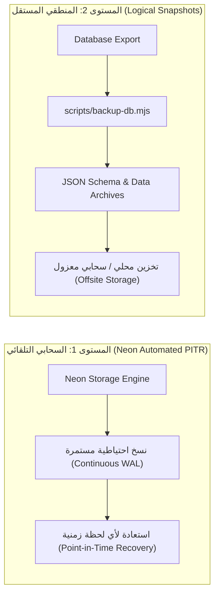

# 12 — خطة النسخ الاحتياطي، الاستعادة والصيانة الدورية (Backup, Recovery & Maintenance)

يوثق هذا الدليل الاستراتيجية الشاملة للنسخ الاحتياطي لقاعدة البيانات وأصول الوسائط في نظام «ناقر منيو»، مع خطة التعافي من الكوارث (Disaster Recovery Plan) وإجراءات الصيانة الوقائية الدورية.

---

## 1. استراتيجية النسخ الاحتياطي لقاعدة البيانات (Database Backup Strategy)

تعتمد استراتيجية حماية البيانات في ناقر منيو على مستويين متكاملين:



### المستوى 1: النسخ الاحتياطي التلقائي المستمر عبر Neon
* توفر منصة **Neon** نسخاً احتياطياً مستمراً لكافة العمليات عبر سجلات المعاملات (Write-Ahead Logging - WAL).
* **في الخطة المجانية:** يتم الاحتفاظ بنسخ احتياطية دورية مع إمكانية استنساخ فرع (Branching) للبيانات في أي وقت كنسخة طبق الأصل للتجربة.
* **في باقات الإنتاج (Launch/Scale):** ميزة الاستعادة اللحظية (Point-in-Time Recovery - PITR) لمدة 7 أيام أو 30 يوماً، مما يتيح استرجاع قاعدة البيانات لأي ثانية محددة قبل حدوث أي خطأ بشري أو عطل.

### المستوى 2: سكريبت النسخ الاحتياطي المنطقي المستقل (`scripts/backup-db.mjs`)
يوفر المشروع سكريبت أتمتة مخصص لأخذ لقطة كاملة لبيانات كافة الجداول:
```bash
node scripts/backup-db.mjs
```
* **المخرجات:** ملف مضغوط أو مهيكل بصيغة JSON داخل مجلد `backups/` يحمل الطابع الزمني للعملية.
* **البيانات المشمولة:** المنتجات، التصنيفات، الأقسام، الأحجام، الإضافات، العروض، الفروع، وسجلات التدقيق.
* **التحقق من صحة الاستعادة:** تم بناء سكريبت فحص سلامة الاستعادة التلقائي:
  ```bash
  node scripts/verify-backup-and-restore.mjs
  ```
  يقوم بإنشاء قاعدة بيانات اختبارية مؤقتة، واستعادة كافة السجلات، ومقارنة البصمات الإلكترونية (Checksums) للتأكد من مطابقة البيانات المستعادة بنسبة 100%.

---

## 2. النسخ الاحتياطي للوسائط والصور (Media & Cloudinary Backup)

* **الصور المحلية (137 صورة):** محفوظة داخل مستودع المشروع في مجلد `public/images/products/` ومحمية بواسطة نظام Git.
* **الصور السحابية المرفوعة (Cloudinary Assets):**
  * جميع الصور المرفوعة حديثاً بواسطة المشرف تُخزن داخل مجلد معزول محدد عبر `CLOUDINARY_SECURE_FOLDER`.
  * يمكن تنزيل نسخة احتياطية محلية دورية لكافة الصور السحابية بواسطة Cloudinary CLI أو واجهة لوحة تحكم Cloudinary (`Settings -> Bulk Backup`).

---

## 3. فحوصات السلامة وتكامل البيانات (Integrity & Health Checks)

يحتوي المشروع على أدوات برمجية متقدمة لفحص النزاهة الهيكلية لقاعدة البيانات:

### فحص التكامل النهائي وخلو البيانات من السجلات المعزولة (Orphan Detection):
```bash
node scripts/verify-final-db-integrity.mjs
```
يقوم السكريبت تلقائياً بالتحقق من:
1. عدم وجود أي منتج مرتبط بقسم أو تصنيف محذوف (Zero Orphaned Products).
2. عدم وجود أي حجم (Variant) أو إضافة (Addon) مرتبطة بمنتج غير موجود.
3. التحقق من سلامة علاقات الفروع والأسعار.
4. مطابقة أعداد السجلات في قاعدة البيانات للتقارير المعتمدة.

---

## 4. خطة التعافي من الكوارث (Disaster Recovery Runbook)

| المؤشر | الهدف المحدد | الإجراء |
| :--- | :--- | :--- |
| **زمن استعادة الخدمة (RTO - Recovery Time Objective)** | أقل من **30 دقيقة** | إنشاء مشروع Neon جديد وتوجيه Vercel إليه في حال حدوث كارثة كاملة في المزود. |
| **أقصى فقدان محتمل للبيانات (RPO - Recovery Point Objective)** | أقل من **15 دقيقة** | اعتماد استعادة الـ PITR من Neon، أو استعادة أحدث نسخة احتياطية يومية تم أخذها عبر السكريبت. |

### خطوات استعادة الخدمة في بيئة جديدة (Step-by-Step Restoration):
1. إنشاء قاعدة بيانات جديدة فارغة على Neon.
2. تطبيق بنية الجداول عبر الترحيلات:
   ```bash
   npx prisma migrate deploy
   ```
3. استعادة البيانات من أحدث لقطة احتياطية:
   ```bash
   node scripts/restore-db.mjs backups/backup-latest.json
   ```
4. تحديث قيمة المتغير `DATABASE_URL` في لوحة تحكم Vercel وإعادة النشر (Redeploy).
5. تشغيل فحص النزاهة للتأكد من الجاهزية:
   ```bash
   node scripts/verify-final-db-integrity.mjs
   ```

---

## 5. جدول الصيانة الوقائية الدورية (Maintenance Checklist)

* [ ] **شهرياً:**
  * مراجعة استهلاك الموارد على Vercel و Neon و Cloudinary لضمان البقاء ضمن الحدود المجانية أو المخطط لها.
  * أخذ نسخة احتياطية منطقية وحفظها على قرص تخزين خارجي أو خدمة تخزين سحابية معزولة (مثل Google Drive / AWS S3).
  * فحص سجلات التدقيق (Audit Logs) في لوحة التحكم لمراقبة الأنشطة الإدارية.
* [ ] **ربع سنوياً:**
  * فحص الحزم والترقيات الأمنية للتبعيات عبر `npm audit`.
  * تحديث حزم Next.js و Prisma بعد اختبارها محلياً والتأكد من اجتياز جميع اختبارات Playwright.
  * اختبار مسار استعادة النسخة الاحتياطية عملياً على بيئة تجريبية معزولة للتأكد من سلامة ملفات النسخ.
