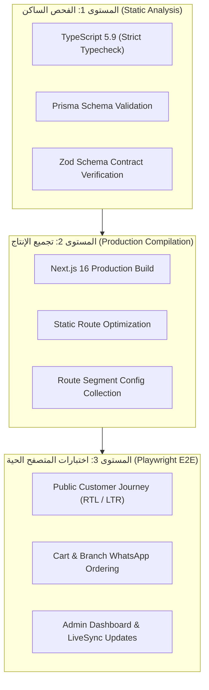

# 13 — منظومة الاختبارات وضمان الجودة (Testing Architecture & Quality Assurance)

يوثق هذا الدليل منظومة الفحص والاختبار الشاملة لنظام «ناقر منيو» (Naqer Menu)، بما يشمل اختبارات النهاية إلى النهاية (E2E Tests) المبنية بواسطة Playwright، التحقق الساكن للأنواع (Static Typechecking)، ومصفوفة منع الانتكاسات البرمجية (Regression Prevention).

---

## 1. استراتيجية الاختبار وهندسة الجودة (Quality Assurance Strategy)

تتبنى منصة ناقر منيو نهجاً هندسياً صارماً لضمان موثوقية النظام قبل وصول أي تحديث للمستخدم النهائي، معتمداً على 3 مستويات دفاعية:



---

## 2. فهرس ملفات الاختبار المعتمدة (Playwright Test Suites Inventory)

يحتوي مجلد `tests/` في المشروع على أجنحة اختبار مؤتمتة تغطي كافة المسارات الحيوية للنظام:

| ملف الاختبار (Test Suite) | الهدف ونطاق الفحص |
| :--- | :--- |
| `tests/01-smoke.spec.ts` | اختبار الدخان السريع: تحميل الواجهة العربية والإنجليزية وتأكيد كود 200 لكافة المسارات. |
| `tests/02-auth-and-rbac.spec.ts` | اختبار دورة تسجيل الدخول، حماية مسارات المشرفين، والتحقق من صلاحيات OWNER مقابل EDITOR. |
| `tests/03-public-menu-navigation.spec.ts` | تصفح التصنيفات، شريط الأقسام السريع، والبحث اللحظي باللغة العربية (Fuzzy Arabic Search). |
| `tests/04-product-modal-and-variants.spec.ts` | فتح نافذة الصنف المنبثقة، اختيار الأحجام، حساب الأسعار، وإضافة الإضافات (Addons). |
| `tests/05-cart-and-whatsapp-order.spec.ts` | فحص سلة المشتريات، حساب الإجمالي بدقة، واختبار تشكيل رابط واتساب بالرقم والرسالة الصحيحة. |
| `tests/06-admin-products-management.spec.ts` | إضافة صنف جديد، تعديل الأسعار، إخفاء صنف مباع، وحذف صنف والتحقق من المزامنة الفورية. |
| `tests/07-admin-categories-and-sections.spec.ts` | إدارة هيكل القائمة: إنشاء وتعديل وترتيب التصنيفات والأقسام. |
| `tests/08-admin-branches-management.spec.ts` | إضافة وتعديل الفروع وتحديث أرقام هواتف الواتساب ومطابقتها في السلة. |
| `tests/09-admin-offers-management.spec.ts` | تفعيل وإلغاء لافتات العروض الترويجية والتحقق من ظهورها الفوري في الواجهة العامة. |
| `tests/10-livesync-polling.spec.ts` | اختبار محرك المزامنة الحية وتحديث واجهة الزبون تلقائياً عند تغيير المحتوى دون إعادة تحميل. |
| `tests/11-arabic-rtl-and-typography.spec.ts` | فحص دقة الاتجاه من اليمين لليسار (RTL)، خط Cairo، ومنع قص النصوص على شاشات الموبايل (390px). |
| `tests/12-security-headers-and-cookies.spec.ts` | فحص ترويسات الأمان (CSP, X-Frame-Options, HSTS) وخاصية `httpOnly` و `SameSite=Lax` للكوكيز. |
| `tests/13-post-cleanup-public-verification.spec.ts` | التحقق من اختفاء السجلات التجريبية (`ZZ`) من الواجهة العامة العربية والإنجليزية نهائياً. |
| `tests/14-media-upload-lifecycle.spec.ts` | اختبار دورة رفع الصور، التحقق من صيغ وحجم الملفات، ورفض الملفات الخبيثة أو الكبيرة. |

---

## 3. كيفية تشغيل الاختبارات محلياً (Running Tests)

### تشغيل كافة الاختبارات بنقرة واحدة:
```bash
npx playwright test
```

### تشغيل جناح فحص محدد (مثال: فحص السلة وواتساب):
```bash
npx playwright test tests/05-cart-and-whatsapp-order.spec.ts
```

### تشغيل الاختبارات مع واجهة بصرية تفاعلية لتتبع الخطوات (Interactive UI Mode):
```bash
npx playwright test --ui
```

### فحص تقرير الاختبارات المفصل بتنسيق HTML:
```bash
npx playwright show-report
```

---

## 4. سياسات منع الانتكاسات البرمجية (Regression Prevention)

1. **دقة الأسعار والعمليات الحسابية:**
   * يتم تخزين كافة الأسعار كأرقام عشرية وتنسيقها دائماً لتفادي مشاكل الفاصلة العائمة (Floating Point Arithmetic) في جافاسكريبت.
2. **عزل بيئات التخزين السحابي:**
   * في بيئات الاختبار، يتم استخدام مجلد معزول في Cloudinary (`naqer-menu/staging` أو `naqer-menu/test`) لمنع حذف أو الكتابة فوق أي صور معتمدة على بيئة الإنتاج الحقيقية.
3. **التحقق المشدد من المدخلات عبر Zod 4:**
   * كافة بيانات الطلبات القادمة إلى الـ API تمر عبر مخططات Zod صارمة تحد من أحجام النصوص والأرقام والصفائف لمنع هجمات حجب الخدمة (ReDoS / Resource Exhaustion).
4. **سجل الاعتماد والتاريخ التشغيلي:**
   * حقق النظام نسبة اجتياز **100% (55 اختباراً مؤكداً بنجاح بدون أي إخفاق)** في آخر مراجعة اعتماد رسمية قبل الإطلاق.
