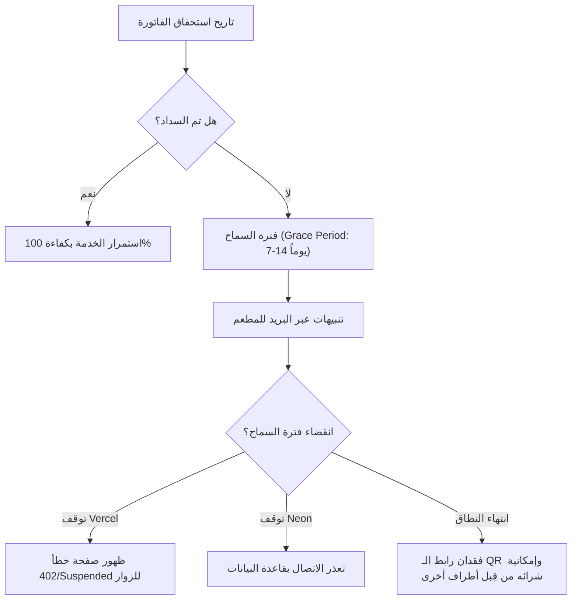

# 16 — مصفوفة ملكية الخدمات والمسؤوليات المالية (Service Ownership, Billing & Legal Responsibilities)

تحدد هذه الوثيقة بوضوح لا لبس فيه الجهة المسؤولة عن امتلاك كل حساب وسداد فواتيره المالية، وما يترتب على التخلف عن السداد، لضمان استمرارية عمل نظام «ناقر منيو» دون أي تداخل في المسؤوليات القانونية أو المالية بين المطور وصاحب المطعم.

---

## 1. مصفوفة ملكية الحسابات والمسؤوليات المالية (Ownership & Billing Matrix)

| الخدمة السحابية | الغرض التشغيلي | مالك الحساب القانوني | الجهة المسؤولة عن السداد | التكلفة التقديرية | دورة الدفع |
| :--- | :--- | :--- | :--- | :--- | :--- |
| **اسم النطاق (Domain Name)** | عنوان الموقع الإلكتروني وطباعة الـ QR | **صاحب المطعم (العميل)** | **صاحب المطعم** | $10 - $15 | سنوياً |
| **استضافة Vercel** | تشغيل الخوادم والواجهة البرمجية | **صاحب المطعم (أو المطور بتفويض)** | **صاحب المطعم** | $0 (Hobby) أو $20 (Pro) | شهرياً |
| **قاعدة بيانات Neon** | تخزين البيانات والعمليات | **صاحب المطعم (أو المطور بتفويض)** | **صاحب المطعم** | $0 (Free) أو $19 (Launch) | شهرياً |
| **سحابة Cloudinary** | تخزين وإدارة صور المنتجات | **صاحب المطعم** | **صاحب المطعم** | $0 (Free Tier يكفي تماماً) | مجاناً |
| **خط واتساب الفروع** | استقبال طلبات الزبائن | **صاحب المطعم** | **صاحب المطعم** (اشتراك الشريحة العادية) | باقة الموبايل المحلية للمطعم | شهرياً |
| **صيانة وتطوير البرمجيات** | الدعم الفني والترقيات بعد الضمان | **المطور** | **صاحب المطعم** (حال التعاقد على صيانة) | حسب العقد المتفق عليه | شهرياً / سنوياً |

---

## 2. سياسة الملكية المستقلة للعميل (Client Ownership Principles)

لتفادي اعتماد المطعم على المطور في الأمور المالية أو تعطل الخدمة مستقبلاً، تطبق القواعد الإلزامية التالية:

1. **تسجيل الحسابات باسم العميل:**
   * يجب أن يُسجل اسم النطاق، وحسابات Vercel و Neon و Cloudinary، ببريد إلكتروني رسمي تابع للمطعم (مثلاً: `admin@naqer-restaurant.com` أو بريد صاحب العمل).
2. **وسيلة الدفع المربوطة (Credit Card):**
   * بطاقة الدفع المربوطة بحسابات الخدمات السحابية يجب أن تكون البطاقة المصرفية المعتمدة للمطعم أو لمالكه، ولا يجوز قانوناً استخدام البطاقة الشخصية للمطور لسداد فواتير البنية التحتية الخاصة بالمطعم.
3. **صلاحيات المطور بعد التسليم:**
   * يتم منح المطور صلاحية وصول فنية (`Developer / Collaborator`) للقيام بأعمال الصيانة والتحديثات البرمجية دون الحاجة لامتلاك حق الوصول للبيانات المالية أو الفواتير.

---

## 3. ماذا يحدث في حال التخلف عن سداد الفواتير؟ (Failure to Pay Consequences)

لتوعية إدارة المطعم بمخاطر التأخر في تجديد الاشتراكات:



### 1. انتهاء اشتراك اسم النطاق (Domain Expiration):
* **فترة السماح:** تمنح شركات النطاقات عادة فترة سماح تتراوح بين 15 إلى 30 يوماً لتجديد النطاق بنفس السعر.
* **الخطر الأكبر:** بعد انقضاء المهلة، يدخل النطاق مرحلة الاسترداد (Redemption Period) بتكلفة مضاعفة، أو يُطرح للبيع العام وقد يشتريه منافس أو طرف خارجي، مما يؤدي إلى تلف كافة رموز الـ QR المطبوعة على طاولات المطعم.

### 2. التخلف عن سداد Vercel Pro أو Neon Launch:
* يتم إرسال إشعارات بريدية متكررة إلى البريد المسجل.
* بعد انتهاء مهلة السماح (7 إلى 14 يوماً)، يتم تخفيض الحساب إلى الباقة المجانية تلقائياً أو تجميد المشروع (Suspended) حتى تسوية المستحقات، مما قد يسبب توقف الموقع الإلكتروني مؤقتاً.

---

## 4. نموذج شهادة نقل ملكية الخدمات السحابية (Ownership Transfer Certificate)

```text
================================================================================
                    شهادة تسليم ونقل ملكية البنية التحتية الرقمية
================================================================================

بموجب هذه الوثيقة، تم نقل وإعداد ملكية الحسابات الرقمية لنظام «ناقر منيو» إلى:
اسم المنشأة / المالك: ...........................................................
البريد الإلكتروني المعتمد: ....................................................

بيان الحسابات المسلمة:
1. اسم النطاق الرسمي: ...........................................................
2. لوحة استضافة التطبيق (Vercel): ............................................
3. قاعدة البيانات السحابية (Neon): ...........................................
4. سحابة إدارة الصور (Cloudinary): ............................................

إقرار العميل:
يقر صاحب العمل باستلامه لكافة بيانات الوصول والإدارة للخدمات المذكورة أعلاه،
ويتحمل من تاريخه المسؤولية القانونية والمالية الكاملة عن تجديد الاشتراكات،
وسداد الرسوم السحابية، والحفاظ على سرية كلمات المرور.

توقيع العميل / المفوض:                                   توقيع المطور:
.................................                       .................................
التاريخ:    /    / 2026 م                               التاريخ:    /    / 2026 م
================================================================================
```
