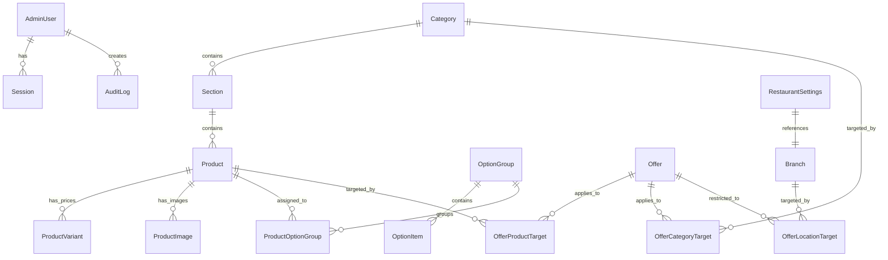

# 06 — Database & Data Management Guide

**Project:** Naqer Menu  
**Scope:** Schema Architecture, Persistence Boundary, Migrations, and Zero-Filesystem Enforcement  
**Target Audience:** Database Administrators, Backend Engineers, DevOps  

---

## 1. مزود قاعدة البيانات ومعمارية الاتصال (Database Provider & Connection)

- **المزود السحابي:** **Neon Serverless PostgreSQL (v16)**.
- **آلية الاتصال (Connection Architecture):**
  - يستخدم التطبيق **Prisma 7** مع محول الاتصال الرسمي `@prisma/adapter-pg` وبركة اتصالات `pg.Pool`.
  - يتم استخدام نقطة اتصال الـ Pooler المشفرة (`-pooler`) مع معاملات:
    - `max: 5` (حد أقصى للاتصالات المتزامنة لكل دالة سيرفرلس لمنع استنزاف خادم Neon).
    - `connectionTimeoutMillis: 15_000` (مهلة 15 ثانية لاستيعاب إقلاع Neon البارد عند الاستيقاظ التلقائي من الخمول).
    - `keepAlive: true` (لتقليل كلفة إعادة مصافحة TLS/DNS).
    - `ssl: { rejectUnauthorized: false }` مهيأ خصيصاً في `lib/database-url.ts` للعمل التام مع شهادات Neon السحابية.

---

## 2. مخطط قاعدة البيانات والجداول الأساسية (Database Schema & Tables)

المخطط معرف بالكامل في [prisma/schema.prisma](file:///e:/real%20projects/naqer-menu/prisma/schema.prisma)، وأهم الجداول:

### تفاصيل الجداول الرئيسية:
1. **`Category`:** أقسام المنيو (مشويات، طواجن، أسماك، مشروبات). تحتوي حقول `slug`, `nameAr`, `group` (FOOD/DRINKS), `layout` (TRAYS/LIST), و `sortOrder`.
2. **`Section`:** الأقسام الفرعية داخل كل تصنيف (مثل قسم "صواني العائلات" داخل قسم "المشويات").
3. **`Product`:** الأصناف. تحتوي على `nameAr`, `descAr`, `ingredientsAr`, `badge` (SIGNATURE/OFFER), `isVisible`, `isAvailable`, و `sortOrder`.
4. **`ProductVariant`:** أسعار وأحجام الطبق (سعر فردي، حجم كبير، بالكيلو، مع `price` و `maxPrice`).
5. **`ProductImage`:** صور الأطباق المربوطة بـ Cloudinary مع `url`, `publicId`, و `isPrimary`.
6. **`OptionGroup` & `OptionItem`:** إضافات وخيارات الأطباق (اختيار الشوربة، نوع الأرز، درجة السبايسي، والصوصات).
7. **`Offer`:** العروض الترويجية وخصومات الأسعار مع الشروط وفترة الصلاحية والفروع المستهدفة.
8. **`Branch`:** بيانات الفروع (فرع جمصة، فرع دمياط الجديدة)، إحداثيات الخريطة، ساعات العمل، وأرقام هواتف الواتساب.
9. **`RestaurantSettings`:** سجل مفرد (`id = "default"`) يحمل اسم المطعم، الشعار، الضريبة، ونسبة الخدمة.
10. **`OrderStore`:** جدول حفظ الطلبات المستلمة عبر المتصفح مع كامل تفاصيل الفاتورة وحالتها.
11. **`AdminUser` & `Session`:** مستخدمو الإدارة وجلسات الدخول المعتمدة على الـ Hash.

---

## 3. المعالجة المعمارية للـ Persistence وحل خطأ `EROFS`

### أصل المشكلة السابقة (Legacy Defect):
كان كود [lib/prisma.ts](file:///e:/real%20projects/naqer-menu/lib/prisma.ts) يعتمد على الشرط التالي:
`const useLocal = process.env.USE_BACKUP_DATA !== "false";`  
عند نشر التطبيق على Vercel بدون تعيين صريح لقيمة المتغير، كان الشرط يتحقق بـ `true`، مما يفوض استعلامات وكتابات الـ Admin إلى محرك `LocalDbEngine`. وعند محاولة إنشاء عرض أو تعديل منتج، كان المحرك يستدعي:
`saveOverlay()` $\rightarrow$ `fs.writeFileSync('/var/task/data/local-db-overlay.json...tmp')`  
مما تسبب في انهيار السيرفر بخطأ نظام ملفات مقروء فقط (`EROFS: read-only file system`).

### الحل المعماري الصارم المطبق في الـ Commit `94887ff9`:
1. **إنشاء [lib/persistence-mode.ts](file:///e:/real%20projects/naqer-menu/lib/persistence-mode.ts):**
   - تم صياغة قاعدة حاسمة: **في أي بيئة إنتاج أو سيرفرلس (`VERCEL=1` أو `NODE_ENV=production`)، تعيد الدالة `shouldUseLocalBackup()` دائماً وبشكل قاطع القيمة `false`**.
   - لا يُسمح بتفعيل `LocalDbEngine` إلا في جهاز المطور أثناء العمل المحلي الأوفلاين فقط.
2. **الحراس الدفاعيون (Runtime Assertion Guards):**
   - تمت إضافة الدالة `assertNotProduction(operationName)` داخل `LocalDbEngine.saveOverlay()`, `recordCreate()`, `recordUpdate()`, و `recordDelete()`.
   - إذا حاول أي كود كتابة ملف في الإنتاج، يُسقطه الحارس فورياً باستثناء قاتل ويمنع الوصول لنظام الملفات.
3. **شفافية الأعطال (No Silent Fallback):**
   - في حال تعطل الاتصال بقاعدة بيانات Neon في الإنتاج، يرمي النظام خطأ اتصال صريح `PrismaClientKnownRequestError` ولا يقوم بالرجوع الصامت لبيانات الـ JSON القديمة تجنباً لتضليل المستخدمين.

---

## 4. استراتيجية النسخ الاحتياطي والاستعادة (Backup & Recovery)

1. **النسخة المرجعية الكاملة للمطعم:**
   - محفوظة داخل [backups/backup-naqer-verified.json](file:///e:/real%20projects/naqer-menu/backups/backup-naqer-verified.json) وتضم 151 طبقاً معتمداً مع كافة روابط الصور والأسعار ومجموعات الخيارات الأصلية.
2. **النسخ الاحتياطي السحابي التلقائي (Neon Automated Backups):**
   - منصة Neon توفر ميزة Point-in-Time Recovery (PITR) والنسخ الاحتياطي التلقائي اليومي لبيانات PostgreSQL مع إمكانية استعادة البيانات لأي دقيقة سابقة في حال حدوث خطأ بشري.
3. **إجراءات الهجرة الآمنة (Migrations Policy):**
   - يُمنع تشغيل `prisma db push` في بيئة الإنتاج لأنها قد تؤدي لفقدان بيانات.
   - يتم إنشاء ملفات الهجرة عبر `npx prisma migrate dev --name <migration_name>` محلياً أولاً، ثم تطبيقها على الإنتاج عبر `npx prisma migrate deploy`.
